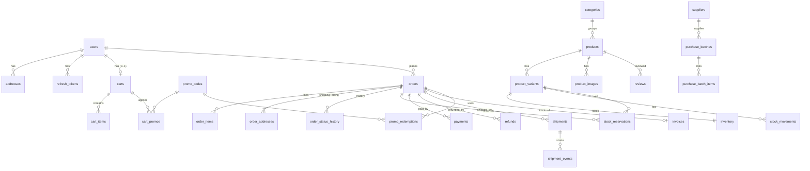

# Dawnlit — Database Schema (MySQL 8, InnoDB, utf8mb4)

Owner: **Architect** (design). Implemented by **Database/Backend-Foundation** in `backend/app/models/*` + `backend/alembic/versions/0001_initial.py`.
Binding inputs: `docs/BRIEF.md`, `docs/DECISIONS.md`. API counterpart: `docs/openapi.yaml`. Process/ownership: `docs/PLAN.md`.

---

## 0. Global conventions (apply to every table)

| Topic | Rule |
|---|---|
| Engine / charset | `ENGINE=InnoDB DEFAULT CHARSET=utf8mb4 COLLATE=utf8mb4_0900_ai_ci` (case-insensitive compare → email uniqueness is case-insensitive; we still store emails lower-cased). |
| Primary keys | `id BIGINT NOT NULL AUTO_INCREMENT` (SQLAlchemy `BigInteger`, signed). FK columns are `BIGINT`. Exceptions: `inventory` (PK = `variant_id`), `invoice_sequences` (PK = `financial_year`), pure link tables (composite PK). |
| Money | `BIGINT NOT NULL` **paise**, column name ends in `_paise`. `CHECK (x >= 0)` unless the column is a signed delta. Never `DECIMAL`/`FLOAT`. |
| Percentages | GST stored as integer percent `gst_rate_percent SMALLINT` (Indian GST slabs are integers). Margins as basis points (int). |
| Time | `DATETIME(6)` holding **UTC** (naive in DB). The PyMySQL connection runs `SET time_zone = '+00:00'` (engine `connect` event / `init_command`) so `CURRENT_TIMESTAMP(6)` is UTC. App-side a `UTCDateTime` TypeDecorator (`app/db/types.py`) converts aware ⇄ naive UTC; all Python datetimes are tz-aware UTC. Business dates (dashboard days, invoice FY, order number date) use **IST (Asia/Kolkata)** computed in app code. `DATE` columns are IST calendar dates. |
| created/updated | `created_at DATETIME(6) NOT NULL DEFAULT CURRENT_TIMESTAMP(6)`; `updated_at DATETIME(6) NOT NULL DEFAULT CURRENT_TIMESTAMP(6) ON UPDATE CURRENT_TIMESTAMP(6)` (where listed as "ts"). |
| Enums | **`VARCHAR(n)` + app-level Python `enum.StrEnum`** in `app/models/enums.py` (same class names as the OpenAPI enum schemas). SQLAlchemy: `Enum(E, native_enum=False, length=n, values_callable=lambda e: [m.value for m in e], validate_strings=True, create_constraint=False)` → stores the **value** (lower-case string), no DB CHECK, so adding a value needs no migration. No MySQL native `ENUM`. |
| Booleans | `TINYINT(1)` (`Boolean`), `NOT NULL` with explicit default. |
| JSON | MySQL `JSON` for small denormalised arrays/objects (highlights, specs, tags, renditions, diffs, raw payloads). Never queried by content except via app code. |
| Soft delete | Only where listed (`archived_at` on products/variants). Everything else hard-deletes or uses `is_active`. |
| Naming convention | SQLAlchemy `MetaData(naming_convention={"ix": "ix_%(table_name)s_%(column_0_N_name)s", "uq": "uq_%(table_name)s_%(column_0_N_name)s", "ck": "ck_%(table_name)s_%(constraint_name)s", "fk": "fk_%(table_name)s_%(column_0_name)s_%(referred_table_name)s", "pk": "pk_%(table_name)s"})`. If a generated name exceeds 64 chars, give it an explicit shorter name. |
| FK ON DELETE | Stated per FK: `CASCADE` for owned children, `RESTRICT` for business history, `SET NULL` for optional actor/author links. `ON UPDATE` is always default (no action). |
| Isolation | Default InnoDB `REPEATABLE READ`. Every read-then-write on stock, promo counters, invoice sequence, and order status uses `SELECT … FOR UPDATE` (SQLAlchemy `.with_for_update()`). |
| Global lock order | To avoid deadlocks every code path that locks more than one kind of row locks in this order: **(1) `orders` row(s) by id → (2) `promo_codes` by id ASC → (3) `inventory` by variant_id ASC → (4) `invoice_sequences`**. `payments`/`refunds`/`webhook_events` rows are locked only after the order row. |
| Transactions | Services `flush()` but never `commit()`. Route handlers / job runners / webhook handlers own the commit (`db.commit()` at the end; `get_db` rolls back on exception). Background tasks open their own `SessionLocal()`. |

Legend for column tables: **N** = nullable (`Y`/blank = NOT NULL). "ts" = the created_at/updated_at pair above.

---

## 1. Entity overview

Tables (39): users, refresh_tokens, otp_codes, addresses, categories, products, product_variants, product_images, inventory, stock_reservations, stock_movements, suppliers, purchase_batches, purchase_batch_items, carts, cart_items, cart_promos, promo_codes, promo_code_products, promo_code_categories, promo_redemptions, orders, order_addresses, order_items, order_status_history, payments, refunds, shipments, shipment_events, invoices, invoice_sequences, reviews, blog_posts, faqs, contact_messages, quiz_results, notifications_log, audit_log, webhook_events.

**Address snapshot decision:** orders snapshot addresses into a separate **`order_addresses`** table (`kind` = shipping | billing, `UNIQUE(order_id, kind)`), not embedded columns. It maps 1:1 to the `OrderAddress` API schema and keeps `orders` narrow.

---

## 2. Identity & auth

### 2.1 `users`
| column | type | N | default | notes |
|---|---|---|---|---|
| id | BIGINT AI | | | PK |
| email | VARCHAR(254) | | | lower-cased; **UNIQUE `uq_users_email`** |
| password_hash | VARCHAR(255) | Y | NULL | argon2 (passlib). NULL for OTP-only accounts |
| full_name | VARCHAR(120) | Y | NULL | |
| phone | VARCHAR(16) | Y | NULL | E.164 `+91XXXXXXXXXX` |
| role | VARCHAR(16) | | 'customer' | `UserRole` |
| is_active | BOOL | | 1 | blocked users cannot log in / refresh |
| email_verified_at | DATETIME(6) | Y | NULL | set on OTP verify |
| marketing_opt_in | BOOL | | 0 | DPDP consent for marketing |
| last_login_at | DATETIME(6) | Y | NULL | |
| created_at / updated_at | ts | | | |

Indexes: `ix_users_role_created_at (role, created_at)` (admin customer list / new-customer counts), `ix_users_phone (phone)` (admin search).

### 2.2 `refresh_tokens`
| column | type | N | default | notes |
|---|---|---|---|---|
| id | BIGINT AI | | | PK |
| user_id | BIGINT | | | FK → users.id **ON DELETE CASCADE** |
| token_hash | CHAR(64) | | | sha256 hex of the opaque token; **UNIQUE** |
| family_id | CHAR(32) | | | rotation family (random hex); reuse of a revoked token revokes the family |
| expires_at | DATETIME(6) | | | now + 30 d |
| revoked_at | DATETIME(6) | Y | NULL | |
| replaced_by_id | BIGINT | Y | NULL | FK → refresh_tokens.id ON DELETE SET NULL |
| user_agent | VARCHAR(255) | Y | NULL | truncated |
| ip_hash | CHAR(64) | Y | NULL | HMAC(SECRET_KEY, ip) — never raw IP |
| created_at | DATETIME(6) | | now | |

Indexes: `(user_id, revoked_at)` (revoke-all on password change/block), `(family_id)`, `(expires_at)` (purge job).

### 2.3 `otp_codes`
| column | type | N | default | notes |
|---|---|---|---|---|
| id | BIGINT AI | | | PK |
| email | VARCHAR(254) | | | lower-cased (user may not exist yet) |
| purpose | VARCHAR(16) | | 'login' | |
| code_hash | CHAR(64) | | | HMAC-SHA256(SECRET_KEY-derived otp key, email + ':' + code) |
| attempts | SMALLINT | | 0 | incremented on each wrong verify |
| max_attempts | SMALLINT | | 5 | |
| expires_at | DATETIME(6) | | | now + 10 min |
| consumed_at | DATETIME(6) | Y | NULL | |
| ip_hash | CHAR(64) | Y | NULL | |
| created_at | DATETIME(6) | | now | |

Indexes: `(email, purpose, created_at)` (latest active code; resend throttling), `(expires_at)` (purge). Requesting a new code invalidates (consumes) previous unconsumed codes for that email+purpose.

### 2.4 `addresses`
| column | type | N | default | notes |
|---|---|---|---|---|
| id | BIGINT AI | | | PK |
| user_id | BIGINT | | | FK → users.id **CASCADE** |
| label | VARCHAR(40) | Y | NULL | |
| full_name | VARCHAR(120) | | | |
| phone | VARCHAR(16) | | | |
| line1 | VARCHAR(200) | | | |
| line2 | VARCHAR(200) | Y | NULL | |
| landmark | VARCHAR(120) | Y | NULL | |
| city | VARCHAR(80) | | | |
| state | VARCHAR(60) | | | derived from state_code (`app/core/india.py`) |
| state_code | CHAR(2) | | | `IndianStateCode` |
| pincode | CHAR(6) | | | |
| country | CHAR(2) | | 'IN' | |
| is_default | BOOL | | 0 | app keeps exactly one default per user |
| created_at / updated_at | ts | | | |

Indexes: `(user_id, is_default)`. Max 10 per user (app rule, `ADDRESS_LIMIT`). Hard delete (orders keep their own snapshot).

---

## 3. Catalog

### 3.1 `categories`
| column | type | N | default | notes |
|---|---|---|---|---|
| id | BIGINT AI | | | PK |
| slug | VARCHAR(80) | | | **UNIQUE** |
| name | VARCHAR(120) | | | |
| description | TEXT | Y | NULL | |
| image_url | VARCHAR(500) | Y | NULL | |
| sort_order | INT | | 0 | |
| is_active | BOOL | | 1 | |
| created_at / updated_at | ts | | | |

Index: `(is_active, sort_order)`.

### 3.2 `products`
| column | type | N | default | notes |
|---|---|---|---|---|
| id | BIGINT AI | | | PK |
| category_id | BIGINT | | | FK → categories.id **RESTRICT** (`CATEGORY_NOT_EMPTY`) |
| slug | VARCHAR(120) | | | **UNIQUE** |
| name | VARCHAR(160) | | | |
| tagline | VARCHAR(255) | | '' | |
| description_md | MEDIUMTEXT | | | compliance-reviewed copy |
| highlights | JSON | | `[]` | array of strings |
| specs | JSON | | `[]` | array of `{label, value}` |
| badges | JSON | | `[]` | array of strings |
| hsn_code | VARCHAR(8) | | '9405' | |
| gst_rate_percent | SMALLINT | | 18 | CHECK IN (0,5,12,18,28,40) |
| is_active | BOOL | | 0 | storefront visibility |
| is_featured | BOOL | | 0 | |
| sort_order | INT | | 0 | "featured" sort |
| warranty_months | SMALLINT | | 12 | |
| return_window_days | SMALLINT | | 30 | |
| seo_title | VARCHAR(70) | Y | NULL | |
| seo_description | VARCHAR(160) | Y | NULL | |
| rating_count | INT | | 0 | denormalised, approved reviews only |
| rating_sum | INT | | 0 | average = sum / count (1 dp) |
| rating_dist | JSON | | `{"1":0,...,"5":0}` | per-star counts |
| archived_at | DATETIME(6) | Y | NULL | soft delete |
| created_at / updated_at | ts | | | |

Indexes: `(category_id, is_active, sort_order)` (listing by category), `(is_active, sort_order)` (featured), `(is_active, created_at)` (newest), `(is_active, rating_sum)` is **not** used — rating sort computes `rating_sum/rating_count` in SQL over ≤ a few hundred rows. Price sort uses a correlated `MIN(price_paise)` subquery over active variants (`ix_product_variants_product_id_is_active_price_paise`). Search `q` uses `LIKE %q%` on name/tagline (tiny catalog; no FULLTEXT needed).

Rating aggregate is recomputed by `services.reviews.recompute_product_rating(db, product_id)` whenever a review is approved/rejected/deleted (it locks the product row `FOR UPDATE`).

### 3.3 `product_variants`
| column | type | N | default | notes |
|---|---|---|---|---|
| id | BIGINT AI | | | PK |
| product_id | BIGINT | | | FK → products.id **RESTRICT** |
| sku | VARCHAR(40) | | | **UNIQUE**; `DL-{PRODUCT}-{K}-{BUNDLE}` |
| name | VARCHAR(160) | | | e.g. "Daylight 5500K · Solo" |
| colour_temperature_k | SMALLINT | | | |
| colour_temperature_label | VARCHAR(40) | | | |
| bundle | VARCHAR(32) | | 'solo' | code: solo, duo, floor_stand, travel_case |
| bundle_label | VARCHAR(80) | | | |
| price_paise | BIGINT | | | GST-inclusive, CHECK > 0 |
| compare_at_price_paise | BIGINT | Y | NULL | CHECK NULL or > price_paise (app-validated) |
| weight_grams | INT | | | packed weight, for shipping |
| length_mm / breadth_mm / height_mm | INT | | | packed dims |
| is_default | BOOL | | 0 | exactly one default per product (app rule) |
| is_active | BOOL | | 1 | |
| sort_order | INT | | 0 | |
| archived_at | DATETIME(6) | Y | NULL | |
| created_at / updated_at | ts | | | |

Constraints: **UNIQUE `(product_id, colour_temperature_k, bundle)`** (`VARIANT_OPTIONS_TAKEN`). Indexes: `(product_id, is_active, price_paise)` (price-from, price sort).

### 3.4 `product_images`
| column | type | N | default | notes |
|---|---|---|---|---|
| id | BIGINT AI | | | PK |
| product_id | BIGINT | | | FK → products.id **CASCADE** |
| variant_id | BIGINT | Y | NULL | FK → product_variants.id **SET NULL** |
| storage_path | VARCHAR(500) | | | relative to `STORAGE_DIR/media`, original upload |
| url | VARCHAR(500) | | | largest WebP rendition `/media/products/{product_id}/{uuid}-1600.webp` |
| alt | VARCHAR(200) | | | required (a11y) |
| width / height | INT | | | of largest rendition (CLS) |
| renditions | JSON | | | `[{"width":480,"url":…},{"width":960,…},{"width":1600,…}]` |
| sort_order | INT | | 0 | |
| created_at | DATETIME(6) | | now | |

Index: `(product_id, sort_order)`.

---

## 4. Inventory & purchasing

### 4.1 `inventory` (1 row per variant/SKU)
| column | type | N | default | notes |
|---|---|---|---|---|
| variant_id | BIGINT | | | **PK**, FK → product_variants.id **CASCADE** |
| on_hand | INT | | 0 | physical units in warehouse |
| reserved | INT | | 0 | held by active reservations |
| low_stock_threshold | INT | | 10 | |
| updated_at | DATETIME(6) | | now on update | |

Checks: `ck_inventory_on_hand_nonneg (on_hand >= 0)`, `ck_inventory_reserved_nonneg (reserved >= 0)`, `ck_inventory_reserved_le_on_hand (reserved <= on_hand)`.
`available = on_hand − reserved`. Public stock status: `available <= 0` → out_of_stock; `available <= low_stock_threshold` → low_stock; else in_stock (`services.inventory.stock_status`). Exact numbers are admin-only.
Row is created together with the variant (same transaction).

### 4.2 `stock_reservations`
| column | type | N | default | notes |
|---|---|---|---|---|
| id | BIGINT AI | | | PK |
| order_id | BIGINT | | | FK → orders.id **CASCADE** |
| variant_id | BIGINT | | | FK → product_variants.id **RESTRICT** |
| quantity | INT | | | CHECK > 0 |
| status | VARCHAR(16) | | 'active' | `ReservationStatus`: active, committed, released, expired |
| expires_at | DATETIME(6) | | | now + `RESERVATION_TTL_MINUTES` (15) |
| resolved_at | DATETIME(6) | Y | NULL | when committed/released/expired |
| created_at | DATETIME(6) | | now | |

Constraints: **UNIQUE `(order_id, variant_id)`**. Indexes: `(status, expires_at)` (expiry job), `(variant_id, status)` (archive guard `VARIANT_HAS_RESERVATIONS`).

### 4.3 `stock_movements` (append-only ledger of **on_hand** changes)
| column | type | N | default | notes |
|---|---|---|---|---|
| id | BIGINT AI | | | PK |
| variant_id | BIGINT | | | FK → product_variants.id **RESTRICT** |
| delta | INT | | | non-zero signed |
| on_hand_after | INT | | | snapshot after applying |
| reason | VARCHAR(32) | | | `StockMovementReason` |
| reference_type | VARCHAR(32) | Y | NULL | order, purchase_batch, adjustment, refund |
| reference_id | BIGINT | Y | NULL | |
| note | VARCHAR(500) | Y | NULL | |
| actor_user_id | BIGINT | Y | NULL | FK → users.id **SET NULL** |
| created_at | DATETIME(6) | | now | |

Indexes: `(variant_id, created_at)`, `(reason, created_at)`, `(reference_type, reference_id)`. Reservations do **not** create movements (they live in `stock_reservations`). Invariant (tested by QA): for each variant `SUM(delta) == inventory.on_hand`.

### 4.4 `suppliers`
| column | type | N | default | notes |
|---|---|---|---|---|
| id | BIGINT AI | | | PK |
| name | VARCHAR(160) | | | **UNIQUE** (`SUPPLIER_NAME_TAKEN`) |
| contact_name | VARCHAR(120) | Y | NULL | |
| email | VARCHAR(254) | Y | NULL | |
| phone | VARCHAR(32) | Y | NULL | international format |
| country | CHAR(2) | | 'CN' | |
| city | VARCHAR(80) | Y | NULL | |
| address | VARCHAR(500) | Y | NULL | |
| notes | TEXT | Y | NULL | |
| is_active | BOOL | | 1 | |
| created_at / updated_at | ts | | | |

### 4.5 `purchase_batches`
| column | type | N | default | notes |
|---|---|---|---|---|
| id | BIGINT AI | | | PK |
| supplier_id | BIGINT | | | FK → suppliers.id **RESTRICT** (`SUPPLIER_HAS_BATCHES`) |
| reference | VARCHAR(40) | | | **UNIQUE** (PO/invoice no.) |
| status | VARCHAR(16) | | 'draft' | `PurchaseBatchStatus` |
| ordered_on | DATE | Y | NULL | |
| received_at | DATETIME(6) | Y | NULL | |
| shipping_paise | BIGINT | | 0 | freight + insurance |
| duty_paise | BIGINT | | 0 | BCD + SWS |
| other_charges_paise | BIGINT | | 0 | clearing, port, local transport |
| gst_paise | BIGINT | | 0 | import IGST paid |
| gst_claimable | BOOL | | 1 | ITC → excluded from landed cost |
| notes | TEXT | Y | NULL | |
| created_by_id | BIGINT | Y | NULL | FK → users.id **SET NULL** |
| created_at / updated_at | ts | | | |

Indexes: `(supplier_id, created_at)`, `(status, created_at)`.

### 4.6 `purchase_batch_items`
| column | type | N | default | notes |
|---|---|---|---|---|
| id | BIGINT AI | | | PK |
| batch_id | BIGINT | | | FK → purchase_batches.id **CASCADE** |
| variant_id | BIGINT | | | FK → product_variants.id **RESTRICT** |
| quantity | INT | | | CHECK > 0 |
| unit_cost_paise | BIGINT | | | supplier unit price in INR, ex-GST |
| allocated_shipping_paise | BIGINT | | 0 | computed on save |
| allocated_duty_paise | BIGINT | | 0 | |
| allocated_other_paise | BIGINT | | 0 | |
| allocated_gst_paise | BIGINT | | 0 | 0 when gst_claimable |
| landed_unit_cost_paise | BIGINT | | 0 | computed on save |

Constraints: **UNIQUE `(batch_id, variant_id)`**. Index: `(variant_id)` (margins, last landed cost).

**Landed cost algorithm** (`services.admin_purchasing`, recomputed on every create/update of a draft and frozen on receive):
1. `goods_i = quantity_i × unit_cost_paise_i`.
2. For each batch charge C ∈ {shipping, duty, other, gst (only if `gst_claimable = false`)}: `alloc_i = allocate_pro_rata(C, weights=[goods_i])` — largest-remainder method, ties broken by lower line id (`app/core/money.allocate_pro_rata`), so Σ alloc_i == C exactly.
3. `landed_unit_cost_paise_i = round_half_up_div(goods_i + Σ alloc_i, quantity_i)`.
4. Margin (response-time, not stored): `net = taxable_value(variant.price_paise, product.gst_rate_percent)`; `margin = net − landed_unit_cost`; `margin_bps = sign(margin) × round_half_up_div(|margin| × 10000, net)`.
5. Weighted average landed cost per variant (VariantMargin) = `round_half_up_div(Σ landed_unit × qty, Σ qty)` over **received** batches; `last_landed_unit_cost` from the most recently received batch.
Receiving (`draft → received`): lock batch row, then `inventory.apply_movement(+quantity, reason=purchase_receipt, reference=('purchase_batch', id))` per line in variant_id order; set `received_at`.

---

## 5. Cart & promotions

### 5.1 `carts`
| column | type | N | default | notes |
|---|---|---|---|---|
| id | BIGINT AI | | | PK |
| token | VARCHAR(64) | Y | NULL | guest cart token (raw, urlsafe 32 bytes); **UNIQUE** (multiple NULLs allowed). Cookie `dl_cart` = `token.signature` |
| user_id | BIGINT | Y | NULL | FK → users.id **CASCADE**; **UNIQUE** → at most one cart per user |
| email | VARCHAR(254) | Y | NULL | captured at checkout (guests) for abandoned-cart email |
| marketing_opt_in | BOOL | | 0 | consent captured at checkout |
| last_activity_at | DATETIME(6) | | now | bumped on every mutation |
| abandoned_email_sent_at | DATETIME(6) | Y | NULL | |
| created_at / updated_at | ts | | | |

Indexes: `(last_activity_at)` (abandoned-cart job, guest-cart purge after 60 d).
A user cart has `token = NULL`; a guest cart has `user_id = NULL`. Merge on login moves guest items into the user cart (sum quantities, cap at `MAX_QTY_PER_LINE=5` → notice `LINE_QUANTITY_CAPPED`), moves promos that are still valid, then deletes the guest cart. Carts are **never** "converted": after a successful order the items and promos are deleted and the row is reused.

### 5.2 `cart_items`
| column | type | N | default | notes |
|---|---|---|---|---|
| id | BIGINT AI | | | PK |
| cart_id | BIGINT | | | FK → carts.id **CASCADE** |
| variant_id | BIGINT | | | FK → product_variants.id **CASCADE** |
| quantity | SMALLINT | | 1 | CHECK 1..5 |
| added_price_paise | BIGINT | | | price when added/last acknowledged → `PRICE_CHANGED` warning |
| created_at / updated_at | ts | | | |

Constraint: **UNIQUE `(cart_id, variant_id)`**.

### 5.3 `cart_promos`
| column | type | N | default | notes |
|---|---|---|---|---|
| id | BIGINT AI | | | PK |
| cart_id | BIGINT | | | FK → carts.id **CASCADE** |
| promo_id | BIGINT | | | FK → promo_codes.id **CASCADE** |
| applied_at | DATETIME(6) | | now | promos are evaluated in applied_at order |

Constraint: **UNIQUE `(cart_id, promo_id)`**. Max 3 per cart (`PROMO_CART_LIMIT`).

### 5.4 `promo_codes`
| column | type | N | default | notes |
|---|---|---|---|---|
| id | BIGINT AI | | | PK |
| code | VARCHAR(32) | | | upper-case; **UNIQUE** |
| title | VARCHAR(120) | | | |
| description | VARCHAR(500) | Y | NULL | |
| discount_type | VARCHAR(16) | | | `DiscountType` |
| percent_off | SMALLINT | Y | NULL | 1..100, required for percentage |
| amount_off_paise | BIGINT | Y | NULL | required for flat |
| max_discount_paise | BIGINT | Y | NULL | cap (percentage) |
| min_order_paise | BIGINT | | 0 | vs cart subtotal (pre-discount) |
| usage_limit_total | INT | Y | NULL | |
| usage_limit_per_user | INT | Y | NULL | per user_id, and per email |
| times_redeemed | INT | | 0 | counter of non-released redemptions; maintained under `FOR UPDATE` |
| starts_at | DATETIME(6) | Y | NULL | |
| ends_at | DATETIME(6) | Y | NULL | |
| first_order_only | BOOL | | 0 | |
| stackable | BOOL | | 0 | |
| is_active | BOOL | | 1 | |
| created_by_id | BIGINT | Y | NULL | FK → users.id **SET NULL** |
| created_at / updated_at | ts | | | |

Indexes: `(is_active, ends_at)`. Check: `ck_promo_codes_times_redeemed_nonneg (times_redeemed >= 0)`.

### 5.5 `promo_code_products` / `promo_code_categories` (restrictions)
| table | columns | keys |
|---|---|---|
| promo_code_products | promo_id BIGINT FK → promo_codes **CASCADE**, product_id BIGINT FK → products **CASCADE** | PK (promo_id, product_id); index (product_id) |
| promo_code_categories | promo_id BIGINT FK → promo_codes **CASCADE**, category_id BIGINT FK → categories **CASCADE** | PK (promo_id, category_id); index (category_id) |

No rows in either table ⇒ promo applies to all lines. Otherwise a line is eligible if its product is listed OR its category is listed.

### 5.6 `promo_redemptions`
| column | type | N | default | notes |
|---|---|---|---|---|
| id | BIGINT AI | | | PK |
| promo_id | BIGINT | | | FK → promo_codes.id **RESTRICT** |
| order_id | BIGINT | | | FK → orders.id **CASCADE** |
| user_id | BIGINT | Y | NULL | FK → users.id **SET NULL** |
| email | VARCHAR(254) | | | lower-cased order email |
| discount_paise | BIGINT | | | |
| status | VARCHAR(16) | | 'reserved' | `RedemptionStatus`: reserved, redeemed, released |
| created_at / updated_at | ts | | | |

Constraints: **UNIQUE `(promo_id, order_id)`**. Indexes: `(promo_id, user_id, status)`, `(promo_id, email, status)`.

### 5.7 Promo rules & usage-limit concurrency

Evaluation (`services.promos`, used by pricing, `validatePromo`, `applyCartPromo`, checkout), in this order — first failure wins:
`PROMO_NOT_FOUND` (no row) → `PROMO_INACTIVE` (`is_active=0`) → `PROMO_NOT_STARTED` (`now < starts_at`) → `PROMO_EXPIRED` (`now >= ends_at`) → `PROMO_NOT_APPLICABLE` (no eligible lines) → `PROMO_MIN_ORDER` (cart subtotal < min_order) → `PROMO_USAGE_LIMIT` (`times_redeemed >= usage_limit_total`) → `PROMO_USER_LIMIT` (non-released redemptions for this user_id or email ≥ per-user limit) → `PROMO_FIRST_ORDER_ONLY` (user/email has any order whose status ≠ cancelled, excluding the current order) → stacking: `PROMO_NOT_STACKABLE` (adding a non-stackable promo when any promo is attached, or any promo when a non-stackable one is attached) → `PROMO_ALREADY_APPLIED` / `PROMO_CART_LIMIT` (apply only).
Guests: per-user and first-order checks use the checkout email; at apply time without an email they pass provisionally and are re-checked at checkout.

Discount math: percentage → `round_half_up_div(eligible_subtotal × percent_off, 100)`, then `min(·, max_discount_paise)`; flat → `min(amount_off_paise, eligible_subtotal_remaining)`. Multiple (stackable) promos apply sequentially in `applied_at` order on the remaining eligible amount; total discount ≤ subtotal. The discount is allocated across eligible lines with `allocate_pro_rata` (weights = remaining line amounts) → `line_discount_paise`, which reduces each line's GST taxable value.

**Redemption with concurrency safety (inside the checkout transaction):**
1. After inserting the `orders` row (lock order #1), `SELECT … FROM promo_codes WHERE id IN (:ids) ORDER BY id FOR UPDATE` (lock order #2).
2. Re-run the full rule evaluation against the locked rows and the order's email/user (counts read under the lock are authoritative because every writer of `times_redeemed` holds this row lock).
3. Insert `promo_redemptions(status='reserved')` and `UPDATE promo_codes SET times_redeemed = times_redeemed + 1`.
4. Any failure raises `PromoError` (422 `PROMO_*`) and the whole checkout transaction rolls back (no order, no reservation).
5. `services.promos.redeem_for_order` (mark_paid / COD placement): reserved → redeemed. `release_redemptions` (cancel / expiry / failed oversell): lock order → lock promo rows → status released, `times_redeemed − 1`.
The UNIQUE `(promo_id, order_id)` guarantees a promo is counted at most once per order even under retries.

---

## 6. Orders

### 6.1 `orders`
| column | type | N | default | notes |
|---|---|---|---|---|
| id | BIGINT AI | | | PK |
| order_number | VARCHAR(20) | | | `DL-YYMMDD-XXXXXX` (IST date + 6 random base32 chars A–Z2–7); **UNIQUE**; regenerate on collision |
| user_id | BIGINT | Y | NULL | FK → users.id **SET NULL** (guest = NULL) |
| cart_id | BIGINT | Y | NULL | FK → carts.id **SET NULL** |
| email | VARCHAR(254) | | | lower-cased |
| phone | VARCHAR(16) | | | |
| status | VARCHAR(24) | | 'pending' | `OrderStatus` |
| payment_method | VARCHAR(16) | | | `PaymentMethod` |
| payment_status | VARCHAR(24) | | 'created' | `PaymentStatus` (order-level summary) |
| currency | CHAR(3) | | 'INR' | |
| subtotal_paise | BIGINT | | | Σ line_subtotal |
| discount_paise | BIGINT | | 0 | |
| shipping_paise | BIGINT | | 0 | |
| cod_fee_paise | BIGINT | | 0 | |
| total_paise | BIGINT | | | subtotal − discount + shipping + cod_fee |
| refunded_paise | BIGINT | | 0 | Σ processed refunds |
| taxable_value_paise | BIGINT | | | Σ over item + shipping + COD tax lines |
| cgst_paise / sgst_paise / igst_paise | BIGINT | | 0 | |
| tax_paise | BIGINT | | | cgst + sgst + igst |
| place_of_supply_state_code | CHAR(2) | | | = shipping address state_code |
| buyer_gstin | VARCHAR(15) | Y | NULL | |
| notes | VARCHAR(500) | Y | NULL | |
| whatsapp_opt_in | BOOL | | 0 | consent from checkout (`whatsapp_updates`) |
| access_token_hash | CHAR(64) | | | sha256(order_access_token) |
| idempotency_key | VARCHAR(64) | Y | NULL | **UNIQUE** (client UUID) |
| reservation_expires_at | DATETIME(6) | Y | NULL | online orders while pending |
| placed_at | DATETIME(6) | | now | |
| paid_at, packed_at, shipped_at, delivered_at, cancelled_at, returned_at, refunded_at | DATETIME(6) | Y | NULL | set by `transition_status` |
| cancel_reason | VARCHAR(255) | Y | NULL | |
| created_at / updated_at | ts | | | |

Indexes (query patterns): `(user_id, placed_at)` my orders; `(status, placed_at)` admin filter + expiry; `(payment_method, placed_at)`; `(payment_status, placed_at)`; `(placed_at)` date range/dashboard; `(email)` tracking/first-order/per-user; `(phone)` tracking/search; `(cart_id, status)` cancel previous pending order of the same cart. Checks: all money ≥ 0; `ck_orders_total_math (total_paise = subtotal_paise - discount_paise + shipping_paise + cod_fee_paise)`.

### 6.2 `order_addresses`
| column | type | N | default | notes |
|---|---|---|---|---|
| id | BIGINT AI | | | PK |
| order_id | BIGINT | | | FK → orders.id **CASCADE** |
| kind | VARCHAR(16) | | | `shipping` \| `billing` |
| full_name, phone, line1, line2(N), landmark(N), city, state, state_code, pincode, country | same types as `addresses` | | | snapshot |

Constraint: **UNIQUE `(order_id, kind)`**. Index: `(pincode)` (ops lookups).

### 6.3 `order_items`
| column | type | N | default | notes |
|---|---|---|---|---|
| id | BIGINT AI | | | PK |
| order_id | BIGINT | | | FK → orders.id **CASCADE** |
| product_id | BIGINT | Y | NULL | FK → products.id **SET NULL** |
| variant_id | BIGINT | Y | NULL | FK → product_variants.id **SET NULL** |
| product_slug | VARCHAR(120) | | | snapshot |
| product_name | VARCHAR(160) | | | snapshot |
| variant_name | VARCHAR(160) | | | snapshot |
| sku | VARCHAR(40) | | | snapshot |
| image_url | VARCHAR(500) | Y | NULL | snapshot |
| hsn_code | VARCHAR(8) | | | snapshot |
| gst_rate_percent | SMALLINT | | | snapshot |
| quantity | INT | | | CHECK > 0 |
| unit_price_paise | BIGINT | | | |
| compare_at_price_paise | BIGINT | Y | NULL | |
| line_subtotal_paise | BIGINT | | | unit × qty |
| discount_paise | BIGINT | | 0 | allocated promo discount |
| line_total_paise | BIGINT | | | subtotal − discount (GST-inclusive) |
| taxable_value_paise | BIGINT | | | |
| cgst_paise / sgst_paise / igst_paise | BIGINT | | 0 | |

Indexes: `(order_id)`, `(variant_id)` (top products), `(product_id)` (verified-purchase check: user's delivered orders containing product).

### 6.4 `order_status_history`
| column | type | N | default | notes |
|---|---|---|---|---|
| id | BIGINT AI | | | PK |
| order_id | BIGINT | | | FK → orders.id **CASCADE** |
| from_status | VARCHAR(24) | Y | NULL | NULL for the initial `pending` row |
| to_status | VARCHAR(24) | | | |
| note | VARCHAR(500) | Y | NULL | customer-visible only via timeline titles (notes are admin-only) |
| actor_type | VARCHAR(16) | | | `ActorType` |
| actor_user_id | BIGINT | Y | NULL | FK → users.id **SET NULL** |
| created_at | DATETIME(6) | | now | |

Index: `(order_id, created_at)`.

---

## 7. Payments, refunds, shipping, invoices

### 7.1 `payments` (one row per gateway order / COD order)
| column | type | N | default | notes |
|---|---|---|---|---|
| id | BIGINT AI | | | PK |
| order_id | BIGINT | | | FK → orders.id **RESTRICT** |
| provider | VARCHAR(16) | | | `PaymentProvider` (razorpay, mock, cod) |
| status | VARCHAR(24) | | 'created' | `PaymentStatus` |
| amount_paise | BIGINT | | | |
| amount_refunded_paise | BIGINT | | 0 | |
| currency | CHAR(3) | | 'INR' | |
| method_detail | VARCHAR(32) | Y | NULL | upi/card/netbanking/wallet/emi |
| razorpay_order_id | VARCHAR(64) | Y | NULL | **UNIQUE** (`order_…` / `order_mock_…`) |
| razorpay_payment_id | VARCHAR(64) | Y | NULL | **UNIQUE** (`pay_…`) — idempotency anchor |
| razorpay_signature | VARCHAR(128) | Y | NULL | |
| error_code | VARCHAR(64) | Y | NULL | last failure |
| error_description | VARCHAR(255) | Y | NULL | |
| attempts | INT | | 0 | failed attempts on this gateway order |
| captured_at | DATETIME(6) | Y | NULL | |
| failed_at | DATETIME(6) | Y | NULL | |
| gateway_payload | JSON | Y | NULL | scrubbed (no card/VPA/contact fields) |
| created_at / updated_at | ts | | | |

Indexes: `(order_id, created_at)`, `(status, created_at)`.

### 7.2 `refunds`
| column | type | N | default | notes |
|---|---|---|---|---|
| id | BIGINT AI | | | PK |
| order_id | BIGINT | | | FK → orders.id **RESTRICT** |
| payment_id | BIGINT | Y | NULL | FK → payments.id **RESTRICT** (NULL for manual COD refunds) |
| amount_paise | BIGINT | | | CHECK > 0 |
| reason | VARCHAR(255) | | | |
| status | VARCHAR(16) | | 'pending' | `RefundStatus` |
| method | VARCHAR(16) | | | `RefundMethod` |
| provider_refund_id | VARCHAR(64) | Y | NULL | **UNIQUE** (`rfnd_…`) |
| restock | BOOL | | 0 | |
| failure_reason | VARCHAR(255) | Y | NULL | |
| created_by_id | BIGINT | Y | NULL | FK → users.id **SET NULL** |
| processed_at | DATETIME(6) | Y | NULL | |
| created_at / updated_at | ts | | | |

Indexes: `(order_id)`, `(status, created_at)`, `(processed_at)` (dashboard refunds).

### 7.3 `shipments`
| column | type | N | default | notes |
|---|---|---|---|---|
| id | BIGINT AI | | | PK |
| order_id | BIGINT | | | FK → orders.id **CASCADE** |
| provider | VARCHAR(16) | | | `ShippingProvider` |
| provider_order_id | VARCHAR(64) | Y | NULL | |
| provider_shipment_id | VARCHAR(64) | Y | NULL | |
| awb | VARCHAR(40) | Y | NULL | **UNIQUE** |
| courier_name | VARCHAR(80) | Y | NULL | |
| status | VARCHAR(24) | | 'created' | `ShipmentStatus` |
| tracking_url | VARCHAR(500) | Y | NULL | |
| label_url | VARCHAR(500) | Y | NULL | |
| weight_grams | INT | | | |
| length_cm / breadth_cm / height_cm | INT | Y | NULL | |
| eta_date | DATE | Y | NULL | |
| shipped_at / delivered_at | DATETIME(6) | Y | NULL | |
| last_synced_at | DATETIME(6) | Y | NULL | |
| created_at / updated_at | ts | | | |

Indexes: `(order_id)`, `(status, updated_at)` (sync job picks non-terminal shipments). App rule: at most one non-cancelled shipment per order (`SHIPMENT_ALREADY_EXISTS`).

### 7.4 `shipment_events`
| column | type | N | default | notes |
|---|---|---|---|---|
| id | BIGINT AI | | | PK |
| shipment_id | BIGINT | | | FK → shipments.id **CASCADE** |
| status | VARCHAR(24) | | | normalised `ShipmentStatus` |
| raw_status | VARCHAR(80) | Y | NULL | courier's text |
| description | VARCHAR(255) | Y | NULL | |
| location | VARCHAR(120) | Y | NULL | |
| occurred_at | DATETIME(6) | | | |
| created_at | DATETIME(6) | | now | |

Constraint: **UNIQUE `(shipment_id, occurred_at, status)`** (dedupe re-delivered scans). Index: `(shipment_id, occurred_at)`.

### 7.5 `invoices`
| column | type | N | default | notes |
|---|---|---|---|---|
| id | BIGINT AI | | | PK |
| order_id | BIGINT | | | FK → orders.id **RESTRICT**; **UNIQUE** (one invoice per order) |
| invoice_number | VARCHAR(24) | | | `DL/{FY}/{seq:06d}`; **UNIQUE** |
| financial_year | VARCHAR(7) | | | e.g. `2026-27` (Apr–Mar, IST) |
| sequence_no | INT | | | |
| issued_at | DATETIME(6) | | | |
| seller_gstin | VARCHAR(15) | | | snapshot of `SELLER_GSTIN` |
| seller_state_code | CHAR(2) | | | snapshot |
| place_of_supply_state_code | CHAR(2) | | | |
| buyer_gstin | VARCHAR(15) | Y | NULL | |
| taxable_value_paise / cgst_paise / sgst_paise / igst_paise / total_paise | BIGINT | | | snapshot of order totals |
| pdf_path | VARCHAR(500) | Y | NULL | relative to `STORAGE_DIR/invoices` |
| pdf_generated_at | DATETIME(6) | Y | NULL | |
| created_at | DATETIME(6) | | now | |

Constraint: **UNIQUE `(financial_year, sequence_no)`**.

### 7.6 `invoice_sequences`
| column | type | N | default | notes |
|---|---|---|---|---|
| financial_year | VARCHAR(7) | | | **PK** |
| next_value | INT | | 1 | |
| updated_at | DATETIME(6) | | now on update | |

Allocation (`services.invoices.generate_invoice`, inside the mark-paid / ship transaction, after the order lock): `INSERT IGNORE INTO invoice_sequences (financial_year) VALUES (:fy)`; `SELECT next_value … WHERE financial_year=:fy FOR UPDATE`; use it; `UPDATE … next_value = next_value + 1`. Gap-free within committed transactions (a rollback also rolls back the increment). Idempotent: if `invoices.order_id` exists, return it.

---

## 8. Content, engagement, ops

### 8.1 `reviews`
| column | type | N | default | notes |
|---|---|---|---|---|
| id | BIGINT AI | | | PK |
| product_id | BIGINT | | | FK → products.id **CASCADE** |
| user_id | BIGINT | Y | NULL | FK → users.id **SET NULL** |
| author_name | VARCHAR(80) | | | display ("Priya S.") |
| rating | TINYINT | | | CHECK 1..5 |
| title | VARCHAR(120) | | | |
| body | TEXT | | | plain text (rendered escaped) |
| status | VARCHAR(16) | | 'pending' | `ReviewStatus` |
| verified_purchase | BOOL | | 0 | computed at creation: user has an order with status `delivered` containing the product |
| source | VARCHAR(16) | | 'customer' | `customer` \| `demo_seed` (demo rows must be purged before launch) |
| moderated_by_id | BIGINT | Y | NULL | FK → users.id **SET NULL** |
| moderated_at | DATETIME(6) | Y | NULL | |
| moderation_note | VARCHAR(255) | Y | NULL | |
| created_at / updated_at | ts | | | |

Constraints: **UNIQUE `(product_id, user_id)`** (`REVIEW_ALREADY_EXISTS`; NULL user rows unaffected). Indexes: `(product_id, status, created_at)`, `(status, rating, created_at)` (reviews wall, moderation queue).

### 8.2 `blog_posts`
| column | type | N | default | notes |
|---|---|---|---|---|
| id | BIGINT AI | | | PK |
| slug | VARCHAR(160) | | | **UNIQUE** |
| title | VARCHAR(200) | | | |
| excerpt | VARCHAR(400) | | '' | |
| body_md | MEDIUMTEXT | | | markdown with numbered footnote citations |
| cover_image_url | VARCHAR(500) | Y | NULL | |
| cover_image_alt | VARCHAR(200) | Y | NULL | |
| author_name | VARCHAR(80) | | 'Dawnlit Team' | |
| tags | JSON | | `[]` | |
| status | VARCHAR(16) | | 'draft' | `BlogStatus` |
| published_at | DATETIME(6) | Y | NULL | |
| reading_time_minutes | SMALLINT | | 1 | ceil(words / 200) computed on save |
| seo_title | VARCHAR(70) | Y | NULL | |
| seo_description | VARCHAR(160) | Y | NULL | |
| og_image_url | VARCHAR(500) | Y | NULL | |
| created_by_id | BIGINT | Y | NULL | FK → users.id **SET NULL** |
| created_at / updated_at | ts | | | |

Index: `(status, published_at)`. Tag filter uses `JSON_CONTAINS(tags, JSON_QUOTE(:tag))` (few rows).

### 8.3 `faqs`
| column | type | N | default | notes |
|---|---|---|---|---|
| id | BIGINT AI | | | PK |
| question | VARCHAR(300) | | | |
| answer_md | TEXT | | | |
| category | VARCHAR(24) | | | `FaqCategory` |
| sort_order | INT | | 0 | |
| is_active | BOOL | | 1 | |
| created_at / updated_at | ts | | | |

Index: `(is_active, category, sort_order)`.

### 8.4 `contact_messages`
| column | type | N | default | notes |
|---|---|---|---|---|
| id | BIGINT AI | | | PK |
| name | VARCHAR(120) | | | |
| email | VARCHAR(254) | | | |
| phone | VARCHAR(16) | Y | NULL | |
| topic | VARCHAR(16) | | | `ContactTopic` |
| order_number | VARCHAR(20) | Y | NULL | |
| message | TEXT | | | |
| status | VARCHAR(16) | | 'new' | `ContactMessageStatus` (`spam` when honeypot filled) |
| user_id | BIGINT | Y | NULL | FK → users.id **SET NULL** |
| ip_hash | CHAR(64) | Y | NULL | |
| created_at / updated_at | ts | | | |

Index: `(status, created_at)`.

### 8.5 `quiz_results`
| column | type | N | default | notes |
|---|---|---|---|---|
| id | BIGINT AI | | | PK |
| user_id | BIGINT | Y | NULL | FK → users.id **SET NULL** |
| cart_id | BIGINT | Y | NULL | FK → carts.id **SET NULL** |
| answers | JSON | | | `QuizAnswers` |
| recommended_product_id | BIGINT | Y | NULL | FK → products.id **SET NULL** |
| recommended_variant_id | BIGINT | Y | NULL | FK → product_variants.id **SET NULL** |
| routine | JSON | | | `RoutinePlan` |
| created_at | DATETIME(6) | | now | |

Indexes: `(user_id, created_at)`, `(created_at)`.

### 8.6 `notifications_log`
| column | type | N | default | notes |
|---|---|---|---|---|
| id | BIGINT AI | | | PK |
| kind | VARCHAR(40) | | | `NotificationKind` |
| channel | VARCHAR(16) | | | `NotificationChannel` |
| status | VARCHAR(16) | | 'queued' | `NotificationStatus` |
| recipient | VARCHAR(254) | | | email or E.164 phone (DB only; app logs print `recipient_masked`) |
| order_id | BIGINT | Y | NULL | FK → orders.id **SET NULL** |
| user_id | BIGINT | Y | NULL | FK → users.id **SET NULL** |
| template | VARCHAR(64) | | | e.g. `email/order_confirmed` |
| context | JSON | Y | NULL | render context for worker retries; **NULL for otp_login** (never persist secrets) |
| dedupe_key | VARCHAR(128) | Y | NULL | **UNIQUE**, e.g. `order_confirmed:email:{order_id}` → mark_paid replays never double-send |
| provider | VARCHAR(32) | Y | NULL | console, smtp, mock_whatsapp, http |
| provider_message_id | VARCHAR(128) | Y | NULL | |
| attempts | SMALLINT | | 0 | max 3 |
| error | VARCHAR(500) | Y | NULL | no PII |
| sent_at | DATETIME(6) | Y | NULL | |
| created_at / updated_at | ts | | | |

Indexes: `(status, created_at)` (worker queue), `(order_id)`, `(user_id)`.

### 8.7 `audit_log`
| column | type | N | default | notes |
|---|---|---|---|---|
| id | BIGINT AI | | | PK |
| actor_user_id | BIGINT | Y | NULL | FK → users.id **SET NULL** |
| actor_email | VARCHAR(254) | Y | NULL | snapshot |
| action | VARCHAR(64) | | | dotted, e.g. `order.status_update` |
| entity_type | VARCHAR(40) | | | |
| entity_id | VARCHAR(64) | | | |
| diff | JSON | Y | NULL | `{field: [old, new]}`; passwords/tokens/secrets redacted |
| ip_hash | CHAR(64) | Y | NULL | |
| user_agent | VARCHAR(255) | Y | NULL | |
| created_at | DATETIME(6) | | now | |

Indexes: `(entity_type, entity_id, created_at)`, `(actor_user_id, created_at)`, `(action, created_at)`, `(created_at)`. Append-only (no update/delete endpoints).

### 8.8 `webhook_events`
| column | type | N | default | notes |
|---|---|---|---|---|
| id | BIGINT AI | | | PK |
| source | VARCHAR(24) | | | `razorpay`, `shiprocket`, `mock_shipping` |
| event_id | VARCHAR(128) | | | Razorpay `X-Razorpay-Event-Id`; shipping: provider id or sha256(awb\|status\|timestamp) |
| event_type | VARCHAR(64) | | | |
| status | VARCHAR(16) | | 'received' | `WebhookEventStatus`: received, processed, ignored, failed |
| payload | JSON | | | scrubbed |
| error | VARCHAR(500) | Y | NULL | |
| attempts | SMALLINT | | 1 | |
| received_at | DATETIME(6) | | now | |
| processed_at | DATETIME(6) | Y | NULL | |

Constraint: **UNIQUE `(source, event_id)`**. Index: `(status, received_at)`.
Processing: verify signature on the raw body first (invalid → 400, no row). `INSERT … ` the event; on duplicate-key, `SELECT … FOR UPDATE` the existing row: if `processed`/`ignored` → 200 `{duplicate: true}`; if `failed`/`received` → reprocess (attempts+1). Business effects are themselves idempotent (`mark_paid` no-ops when already captured; refund lookup by `provider_refund_id`).

---

## 9. Stock reservation & commit algorithm (`services.inventory`, owner Backend Commerce)

All functions run inside the caller's transaction and lock in the global order (order row already locked by the caller).

**`reserve_for_order(db, order, ttl=15 min)`** — called by checkout after the order + items + promo redemptions are inserted:
1. Aggregate order_items by variant_id → `{variant_id: qty}`; sort variant ids ascending.
2. `SELECT * FROM inventory WHERE variant_id IN (…) ORDER BY variant_id FOR UPDATE`.
3. For each variant: also verify the variant/product is active (else `VARIANT_UNAVAILABLE`). `available = on_hand − reserved`; if `available <= 0` → collect as OUT_OF_STOCK, if `available < qty` → collect as INSUFFICIENT_STOCK. If any collected → raise `InsufficientStock` (409, `details.variant_ids`) → whole transaction rolls back.
4. `reserved += qty`; insert `stock_reservations(status='active', expires_at=now+ttl)`; set `orders.reservation_expires_at`.

**`commit_reservation(db, order)`** — called by `orders.mark_paid` (online) and immediately after reserve for COD:
1. Lock inventory rows (variant_id ASC) and the order's reservations `FOR UPDATE`.
2. For each **active** reservation: `on_hand −= qty`, `reserved −= qty`, reservation → `committed` (`resolved_at=now`), insert `stock_movements(delta=−qty, reason='sale', reference=('order', id))`.
3. For a reservation that is **expired/released** (payment arrived late): if `on_hand − reserved >= qty` then `on_hand −= qty` + `sale` movement and mark the reservation `committed`; otherwise raise `InsufficientStock` → the caller (`mark_paid`) handles the **late-payment oversell** path (see PLAN §Payments edge cases: order cancelled with note, full refund issued, admin alerted).
4. Clear `orders.reservation_expires_at`.

**`release_reservation(db, order, reason)`** — on cancel/expiry/terminal payment failure of an unpaid online order: lock rows, for each active reservation `reserved −= qty`, status → `released` (or `expired` when reason = expired).

**`restock_order(db, order, reason, actor_user_id)`** — for orders whose stock was already committed (paid or COD) and are cancelled (`order_cancelled`), or `returned`/`delivered` orders fully refunded with `restock=true` (`customer_return`): `on_hand += qty` per item. **Idempotent per order**: skipped when an `order_cancelled`/`customer_return` movement referencing the order already exists.

**`apply_movement(db, variant_id, delta, reason, …)`** — single locked on_hand change used by admin adjustments (via `adjust_stock`, which first rejects non-manual reasons with `ADJUSTMENT_REASON_INVALID`) and batch receipts; rejects `on_hand + delta < reserved` with `STOCK_NEGATIVE` (409).

**Expiry job** (`jobs/reservations.py` → `services.orders.expire_stale_orders`, every 60 s): select order ids with `stock_reservations.status='active' AND expires_at < now` (index `(status, expires_at)`), and for each, in its own short transaction: lock order → skip unless `status='pending' AND payment_method='razorpay'` → `payments.reconcile_gateway_order` (Razorpay: fetch order payments; a captured payment ⇒ `mark_paid` instead) → else `release_reservation(reason='expired')`, `release_redemptions`, `transition_status(cancelled, actor=system, note='Payment window expired')`.

---

## 10. Seed data (`python -m app.seeds`, owner Backend Foundation; the demo-orders part lives in `app/seeds/demo_orders.py`, owned by Backend Commerce and built on the real checkout/payment services — see PLAN §3)

`python -m app.seeds [--essential|--demo|--all] [--purge-demo]`. Default `--all` when `ENV != production`; in production only `--essential` is allowed (`--demo` refuses). All seeds are **idempotent** upserts keyed by natural keys (slug, sku, code, email, reference). Product images are generated placeholder renders shipped in `backend/app/seeds/assets/` and copied into `STORAGE_DIR/media/products/…` with renditions.

### 10.1 Essential
**Users**
| email | role | password | notes |
|---|---|---|---|
| admin@dawnlit.in | admin | env `SEED_ADMIN_PASSWORD`, default `ChangeMe!2026` | default allowed **only when ENV != production** (seed aborts otherwise) |
| staff@dawnlit.in | staff | env `SEED_STAFF_PASSWORD`, default `ChangeMe!2026` | same rule |

**Categories**: `desk-lamps` "Desk lamps" (sort 1), `panels` "Light panels" (2), `portable` "Portable" (3).

**Products** (all `is_active=1`, HSN 9405, GST 18 %, warranty 12 m, returns 30 d):
| slug | name | category | tagline | featured/sort |
|---|---|---|---|---|
| dawnlit-desk | Dawnlit Desk — 10,000 lux desk lamp | desk-lamps | "Your own sunrise, right on your desk." | yes / 1 |
| dawnlit-panel | Dawnlit Panel — large 10,000 lux panel | panels | "Room-filling brightness for your morning routine." | yes / 2 |
| dawnlit-go | Dawnlit Go — portable travel lamp | portable | "Bright mornings that fit in your bag." | no / 3 |

Each product: 4–6 compliance-safe highlights (e.g. "10,000 lux at 30–40 cm", "UV-free diffused LED", "3 brightness levels", "USB-C powered" (Go)), specs rows, `description_md` with the disclaimer line "Not a medical device. Consult a doctor for medical conditions."

**Variants & stock** (price GST-inclusive; low_stock_threshold 10 unless noted; final on_hand after demo orders shown — essential-only installs have the batch quantities instead):
| sku | product | K / label | bundle / label | price ₹ | compare-at ₹ | weight g | batch qty | on_hand after demo | default |
|---|---|---|---|---|---|---|---|---|---|
| DL-DESK-4000-SOLO | desk | 4000 Warm-neutral | solo / Solo | 4,999 | – | 1,400 | 40 | 40 | |
| DL-DESK-4000-DUO | desk | 4000 Warm-neutral | duo / Duo pack | 8,999 | 9,998 | 2,700 | 6 | 6 (**low_stock**) | |
| DL-DESK-5500-SOLO | desk | 5500 Daylight | solo | 4,999 | – | 1,400 | 121 | 120 | ✓ |
| DL-DESK-5500-DUO | desk | 5500 Daylight | duo | 8,999 | 9,998 | 2,700 | 30 | 30 | |
| DL-DESK-6500-SOLO | desk | 6500 Cool | solo | 4,999 | – | 1,400 | 60 | 60 | |
| DL-DESK-6500-DUO | desk | 6500 Cool | duo | 8,999 | 9,998 | 2,700 | 21 | 20 | |
| DL-PANEL-5500-SOLO | panel | 5500 Daylight | solo | 7,999 | – | 3,200 | 46 | 45 | ✓ |
| DL-PANEL-5500-STAND | panel | 5500 Daylight | floor_stand / With floor stand | 9,499 | – | 5,600 | 15 | 15 | |
| DL-PANEL-6500-SOLO | panel | 6500 Cool | solo | 7,999 | – | 3,200 | 25 | 25 | |
| DL-PANEL-6500-STAND | panel | 6500 Cool | floor_stand | 9,499 | – | 5,600 | 0 | 0 (**out_of_stock**) | |
| DL-GO-5500-SOLO | go | 5500 Daylight | solo | 3,499 | – | 450 | 82 | 80 | ✓ |
| DL-GO-5500-CASE | go | 5500 Daylight | travel_case / With travel case | 3,999 | – | 650 | 36 | 35 | |

Dimensions (mm, packed): desk 380×260×90 (duo 380×260×180), panel 520×380×80 (stand 1,250×300×120), go 200×140×50 (case 230×170×70).

**Supplier**: "Shenzhen Brightway Lighting Co., Ltd." (fictional placeholder), contact "Ms. Lin", country CN, city Shenzhen.

**Purchase batches** (both `received`, movements `purchase_receipt`; `gst_claimable = true`):
| reference | lines (variant: qty × unit cost ₹) | shipping ₹ | duty ₹ | other ₹ | import GST ₹ |
|---|---|---|---|---|---|
| PB-2026-001 (received 45 days ago) | DESK-4000-SOLO 40×1,150; DESK-4000-DUO 6×2,250; DESK-5500-SOLO 121×1,150; DESK-5500-DUO 30×2,250; DESK-6500-SOLO 60×1,150; DESK-6500-DUO 21×2,250; GO-5500-SOLO 82×820; GO-5500-CASE 36×980 | 42,000 | 68,000 | 9,500 | 96,000 |
| PB-2026-002 (received 30 days ago) | PANEL-5500-SOLO 46×2,050; PANEL-5500-STAND 15×2,700; PANEL-6500-SOLO 25×2,050 | 30,000 | 41,000 | 6,000 | 55,000 |

**Promo codes**
| code | type | value | max disc. | min order | total limit | per user | first order | stackable | dates |
|---|---|---|---|---|---|---|---|---|---|
| WELCOME10 | percentage | 10 % | ₹500 (50000) | ₹1,999 (199900) | – | 1 | **yes** | yes | starts = seed time − 1 d, no end |
| SUNRISE500 | flat | ₹500 (50000) | – | ₹4,999 (499900) | 1000 | 1 | no | **no** | starts = seed time − 1 d, ends 2027-03-31T18:29:59Z (31 Mar 2027 IST) |
Neither has product/category restrictions. WELCOME10 + SUNRISE500 together → `PROMO_NOT_STACKABLE` (SUNRISE500 is non-stackable).

**FAQs** (10, active): what does 10,000 lux mean (usage) · how long to use it each day (usage) · how far to sit (usage) · best time of day (usage) · is it a medical device? — answer contains the exact disclaimer (safety) · is it UV-free / safe for eyes? — "uses diffused, UV-free LEDs; don't stare directly into the lamp; ask your doctor if you have an eye condition" (safety) · which colour temperature should I choose (product) · delivery times & pincodes (shipping) · COD availability & fee (payments) · 30-day returns & 12-month warranty (returns). One more optional: GST invoice availability (payments).

**Blog posts** (4, `published`, author "Dawnlit Team", each with 2–4 footnoted citations to reputable general sources such as NIH/NIGMS "Circadian Rhythms" fact sheet, Harvard Health Publishing, Sleep Foundation; no disease claims; ends with the disclaimer):
1. `morning-light-routine-for-desk-workers` — "Morning light routine for desk workers"
2. `what-is-lux` — "What is lux? Understanding light intensity in everyday life"
3. `ten-minutes-of-bright-light-busy-mornings` — "How to fit 10 minutes of bright light into a busy morning"
4. `building-a-consistent-daily-rhythm` — "Light, screens and evenings: building a consistent daily rhythm"

### 10.2 Demo (local/staging only — `--purge-demo` removes it before launch)
**Customers** (password env `SEED_DEMO_PASSWORD`, default `DemoPass!2026`): `priya.demo@example.com` (Priya Sharma, +919800000001, address Bandra West, Mumbai 400050, MH 27 — intra-state), `arjun.demo@example.com` (Arjun Rao, +919800000002, address Koramangala, Bengaluru 560034, KA 29 — inter-state).

**Orders** (dates relative to seed time; payments via provider `mock`; full status history + shipments + invoices + notifications_log rows; stock `sale` movements):
| # | customer | items | method | promo | status | placed |
|---|---|---|---|---|---|---|
| 1 | Priya | DESK-5500-SOLO ×1 | razorpay (mock) | WELCOME10 (−₹499.90) | delivered | −12 d |
| 2 | Arjun | PANEL-5500-SOLO ×1 | razorpay (mock) | SUNRISE500 (−₹500) | shipped | −8 d |
| 3 | Priya | GO-5500-CASE ×1 | cod (+₹49) | – | delivered (COD collected) | −6 d |
| 4 | Arjun | DESK-6500-DUO ×1 | razorpay (mock) | – | packed | −2 d |
| 5 | Priya | DESK-4000-SOLO ×1 | razorpay (mock) | – | cancelled (payment window expired, no stock sold) | −4 d |
| 6 | Arjun | GO-5500-SOLO ×2 | cod (+₹49) | – | pending (COD, stock committed) | today |
Invoices exist for orders 1, 2, 3, 4 (sequence follows placement order in the current FY). Promo `times_redeemed`: WELCOME10 = 1, SUNRISE500 = 1.

**Reviews** (12, `approved`): desk ×6, panel ×3, go ×3; ratings: 5,5,5,5,4,4,4,4,5,4,3,5. Two by demo customers (Priya on desk & go — `verified_purchase = true` via delivered orders 1 and 3, `source='customer'`); ten with `user_id NULL`, `verified_purchase = false`, `source='demo_seed'`, author names like "Neha K.", "Rohan M.". All copy is experiential and compliance-safe ("helps me feel more awake during early calls", "easy to fit into my routine"), never therapeutic. Product rating aggregates recomputed after seeding.
