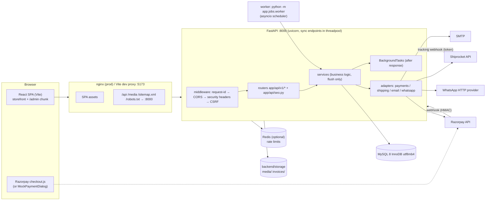
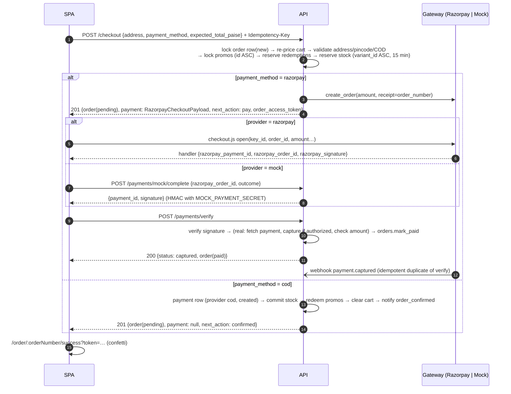
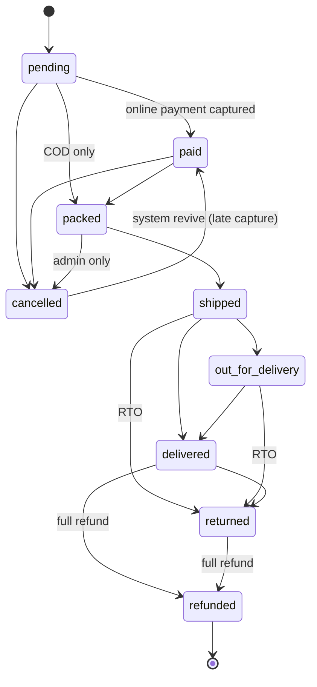

# Dawnlit — Architecture & Execution Plan

Owner: **Architect**. Binding order of precedence: `docs/DECISIONS.md` > `docs/openapi.yaml` (API contract) > `docs/DB_SCHEMA.md` (data) > this file.
Every agent reads: BRIEF, DECISIONS, this PLAN (§3 ownership + §4 interfaces in full), plus the contract/schema sections for its domain.
The contract and DB schema change only through the orchestrator ("change request": reason, exact diff, affected agents).

---

## 1. Architecture

### 1.1 Overview



| Concern | Decision |
|---|---|
| Process model | 1 API process (uvicorn, N workers) + 1 worker process. Both import the same `app` package. |
| DB access | Sync SQLAlchemy 2.0 `Session` per request (`get_db`). Services `flush()`; route handlers / job runners / webhook handlers `commit()`. |
| Same origin | Dev: Vite :5173 proxies `/api`, `/media`, `/sitemap.xml`, `/robots.txt` to :8000 (also `preview.proxy` for `vite preview` :4173). Prod: nginx. Cookies are first-party, `SameSite=Lax`. |
| Static media | FastAPI mounts `StaticFiles` at `/media` → `STORAGE_DIR/media`. Invoices are **never** public; served via authenticated routes only. |
| Mock-first | Every external integration has a mock that is the default when credentials are empty (payments, shipping, email, WhatsApp). The whole flow runs offline. |

### 1.2 Request flow (backend)

| # | Layer | Responsibility | Owner |
|---|---|---|---|
| 1 | `RequestContextMiddleware` (pure ASGI) | `X-Request-ID` (accept or generate uuid4), contextvar for logs, timing access log (method, route template, status, ms — no query strings, no bodies) | Foundation |
| 2 | `CORSMiddleware` | `CORS_ORIGINS` list, `allow_credentials=True`, expose `Retry-After`, `X-Request-ID` | Foundation |
| 3 | `SecurityHeadersMiddleware` | `X-Content-Type-Options`, `Referrer-Policy: strict-origin-when-cross-origin`, `X-Frame-Options: DENY`, `Permissions-Policy` | Foundation |
| 4 | `CSRFMiddleware` (pure ASGI) | POST/PUT/PATCH/DELETE under `/api/v1/` except `/api/v1/payments/webhook/` and `/api/v1/shipping/webhook/`: header `X-CSRF-Token` must equal cookie `dl_csrf` (`hmac.compare_digest`) else 403 `CSRF_FAILED` | Foundation |
| 5 | GZip (≥ 1 KB) | | Foundation |
| 6 | Route dependencies | `RateLimit(...)` → `get_db` → `get_optional_user`/`get_current_user`/`require_role` → handler | Foundation (deps) / owners (routes) |
| 7 | Exception handlers | `AppError` → its status + `ErrorResponse`; `RequestValidationError` → 422 `VALIDATION_ERROR` (`details.fields`); Starlette 404/405 → `NOT_FOUND`/`METHOD_NOT_ALLOWED`; unhandled → 500 `INTERNAL_ERROR` (logged with request id, scrubbed) | Foundation |

FastAPI app settings: `separate_input_output_schemas=False` (so generated component names equal contract names), `openapi_url="/api/v1/openapi.json"`, docs at `/api/docs` (disabled when `ENV=production` unless `API_DOCS_ENABLED=true`). Routers declare **no prefix**; each decorator spells the path after `/api/v1` (e.g. `@router.get("/users/me/orders", operation_id="listMyOrders", response_model=OrderSummaryPage)`). `main.py` includes every v1 router with `prefix="/api/v1"` and `seo.router` at root.
Webhook routes are `async def` (they need `await request.body()` for the raw signature body) and run the sync processing with `run_in_threadpool`. All other routes are plain `def`.

### 1.3 Auth, CSRF and cart cookie flow

| Cookie | httpOnly | TTL | Path | Set by | Cleared by |
|---|---|---|---|---|---|
| `dl_access` | yes | 15 min | `/` | signup, login, otp/verify, refresh | logout, blocked user |
| `dl_refresh` | yes | 30 d (rotating) | `/api/v1/auth` | same | logout, family revoke |
| `dl_csrf` | **no** | 7 d | `/` | `GET /auth/csrf`; rotated on login/logout | — |
| `dl_cart` | yes | 60 d | `/` | first `addCartItem` as guest | login (after merge), logout |
All: `SameSite=Lax`, `Secure` iff `ENV=production`, optional `COOKIE_DOMAIN`.

- **Access JWT**: HS256 with `SECRET_KEY`; claims `sub` (user id as str), `role`, `typ="access"`, `iat`, `exp`, `jti`. `get_current_user` decodes **and loads the user row** (blocked users rejected immediately: 403 `AUTH_ACCOUNT_DISABLED`).
- Token present but expired → 401 `AUTH_TOKEN_EXPIRED` (also on optional-auth endpoints, so the client refreshes instead of silently acting as a guest). Token invalid → 401 `UNAUTHENTICATED` + clear cookie. No token → guest (optional) / 401 `UNAUTHENTICATED` (required).
- **Refresh**: opaque 32-byte token; DB stores sha256 in `refresh_tokens`; each use rotates (old row `revoked_at`, `replaced_by_id`); presenting a revoked token revokes the whole `family_id` → 401 `AUTH_REFRESH_INVALID`. Password change / admin block → `services.auth.revoke_all_refresh_tokens`.
- **CSRF** (double submit): SPA boot → `ensureCsrfToken()` (calls `GET /api/v1/auth/csrf` if `document.cookie` lacks `dl_csrf`). Every unsafe call sends `X-CSRF-Token`. On 403 `CSRF_FAILED` the client re-issues the token and retries **once**.
- **Client 401 handling**: on 401 `AUTH_TOKEN_EXPIRED` → single-flight `POST /auth/refresh` → retry original once; refresh failure → clear session cache (`queryKeys.me` → null) and continue as guest.
- **Guest cart**: `carts.token` = random urlsafe 32 bytes; cookie `dl_cart = token + "." + HMAC_SHA256(SECRET_KEY, token)[:32]` (`core.security.sign_cart_token / verify_cart_token`). Logged-in users always use their `user_id` cart; `dl_cart` is only read for the login merge.
- **Login merge** (signup/login/otp-verify): `services.cart.merge_guest_cart(db, guest_token, user)` → sums quantities (cap 5 → notice `LINE_QUANTITY_CAPPED` on next GET), moves still-valid promos, deletes guest cart; response `AuthResponse.cart_merged`, `Set-Cookie` clears `dl_cart`.
- **OTP**: 6 digits, HMAC-hashed, 10 min, 5 attempts, previous codes invalidated on resend; `dev_code` echoed only when `ENV != production && OTP_DEV_ECHO=true` (tests/E2E).

### 1.4 Checkout & payment flow



Checkout transaction steps (`services/checkout.py::create_checkout`, owner Backend Commerce):
1. **Idempotency**: `Idempotency-Key` found on an existing order of the same cart/user → return the original `CheckoutResponse` (201 replay; a fresh `order_access_token` is minted and its hash replaces the stored one).
2. Cancel any previous `pending` **online** order of the same cart (`(cart_id, status)` index) via `orders.cancel_order(reason="superseded")`.
3. `pricing.price_cart(..., payment_method)`; `CART_EMPTY`; any line warning `OUT_OF_STOCK`/`INSUFFICIENT_STOCK`/`VARIANT_UNAVAILABLE` → 409 with that code; `expected_total_paise` given and ≠ server total → 409 `PRICE_CHANGED` (`details.expected_total_paise`, `actual_total_paise`).
4. Address: `address_id` (must belong to user, else 404 `ADDRESS_NOT_FOUND`) or `shipping_address` (`ADDRESS_REQUIRED` if neither); guest without email → `EMAIL_REQUIRED`.
5. `shipping.assert_serviceable(pincode, cod=...)` → `PINCODE_NOT_SERVICEABLE` / `COD_NOT_AVAILABLE`; COD total > `COD_MAX_ORDER_PAISE` → `COD_LIMIT_EXCEEDED`.
6. Insert `orders` (status `pending`, number `DL-YYMMDD-XXXXXX`, retry on unique collision), `order_addresses`, `order_items` (snapshots + GST per §1.8), initial `order_status_history(from NULL → pending, actor customer)`.
7. `promos.reserve_redemptions` (locks + full re-evaluation with the order email) → `inventory.reserve_for_order`.
8. Online: `payments.create_gateway_payment(db, order)` (payments row `created`, gateway order with `notes.order_number`); gateway error → 502 `PAYMENT_GATEWAY_ERROR` and the **whole transaction rolls back**.
   COD: `payments.create_cod_payment` → `inventory.commit_reservation` → `promos.redeem_for_order` → `orders.clear_cart_after_order` → `notifications.notify(order_confirmed)`.
9. Commit; return `CheckoutResponse` with `order_access_token` (32 random bytes; DB keeps sha256).

`retryPayment`: order must be `pending` + online (`ORDER_NOT_CANCELLABLE` reused per contract when not pending; `ORDER_ALREADY_PAID` when captured); `reservation_expires_at < now` → 409 `RESERVATION_EXPIRED`. Returns a payload for the **same** gateway order (Razorpay allows multiple attempts per order).
`reportPaymentFailure`: informational — increments `payments.attempts`, stores `error_code/description`, sets order `payment_status=failed`; order stays `pending` (retry possible until expiry). Webhook `payment.failed` does the same authoritatively.
Real Razorpay: orders created with `payment_capture=1` (auto-capture); `verify` fetches the payment, captures it if still `authorized`, and requires `amount == order.total_paise` before `mark_paid`.

### 1.5 Webhook idempotency

| Step | Razorpay (`/payments/webhook/razorpay`) | Courier (`/shipping/webhook/{provider}`) |
|---|---|---|
| Auth | `HMAC_SHA256(raw_body, RAZORPAY_WEBHOOK_SECRET) == X-Razorpay-Signature` (compare_digest) else 400 `WEBHOOK_SIGNATURE_INVALID`, **no row written** | `X-Webhook-Token == SHIPPING_WEBHOOK_TOKEN` else 401 `WEBHOOK_UNAUTHORIZED` |
| Event id | `X-Razorpay-Event-Id` | provider event id or `sha256(awb|status|timestamp)` |
| Dedupe | `INSERT webhook_events(source, event_id, status=received)`; duplicate key → `SELECT … FOR UPDATE`: `processed`/`ignored` → 200 `{duplicate: true}`; `received`/`failed` → reprocess (`attempts+1`) | same |
| Effects | `payment.captured`/`order.paid` → lock order → `mark_paid` (no-op if already captured; unique `payments.razorpay_payment_id`); `payment.failed` → record failure; `refund.processed`/`refund.failed` → lookup by `provider_refund_id` → update refund → `orders.handle_full_refund` when fully refunded; anything else → `ignored` | normalise via `adapter.parse_webhook` → `shipping.apply_tracking` (dedupe `UNIQUE(shipment_id, occurred_at, status)`) |
| Outcome | row → `processed` + commit; exception → rollback business effects, row → `failed` with scrubbed error (separate transaction), **still 200** for business failures (Razorpay retries only on non-2xx; we reprocess from the worker), 5xx only for infrastructure errors | same |

### 1.6 Payments edge cases

| Case | Handling |
|---|---|
| verify + webhook race | Both lock the order row first (`SELECT … FOR UPDATE`); the second sees `payments.status=captured` and returns the current state. |
| Duplicate verify call | Idempotent: same response. Different `razorpay_payment_id` for an already-paid order (double payment) → second payment recorded `captured`, **auto-refunded in full**, audit row `payment.duplicate_refunded`. |
| Amount mismatch | Payment recorded `failed` with `error_code=AMOUNT_MISMATCH`; order not paid; WARNING log + audit row (actor system). |
| Late capture after expiry (order `cancelled` with `cancel_reason="payment_window_expired"`) | `mark_paid` attempts the **revive** transition `cancelled → paid` (system only): `inventory.commit_reservation` (handles expired reservations), `promos.restore_redemptions` (honours the paid price without re-validation), invoice, notifications. |
| Late capture, stock gone (oversell) | `InsufficientStock` from commit → order stays `cancelled`, history note "Payment received after window; item unavailable — refunded", `payments.create_refund(full, reason="late_payment_oversell")`, WARNING log + audit row. |
| Capture on an order cancelled by customer/admin | Never revived: auto full refund as above. |
| Expiry job sees a captured payment (missed webhook) | `payments.reconcile_gateway_order` → `mark_paid` instead of cancelling. |
| Mock gateway in production | Refused at startup: `ENV=production` + `PAYMENT_PROVIDER=mock` or missing Razorpay keys → settings validation error. `completeMockPayment` → 404 `MOCK_GATEWAY_DISABLED` whenever gateway ≠ mock. |

Gateway resolution (`adapters.payments.get_payment_gateway()`): `PAYMENT_PROVIDER=mock` → Mock; `razorpay` with both keys → Razorpay; `razorpay` with empty keys → Mock (non-production only) and a startup WARNING. Mock ids: `order_mock_<16hex>`, `pay_mock_<16hex>`, `rfnd_mock_<16hex>`; `key_id = "rzp_test_mock"`; signature = `HMAC_SHA256(order_id + "|" + payment_id, MOCK_PAYMENT_SECRET)` verified by the **same** `verify_signature` code path. Mock refunds are `processed` synchronously.

### 1.7 Order state machine

Statuses (only these): `pending, paid, packed, shipped, out_for_delivery, delivered, cancelled, refunded, returned`.



`services.orders.ALLOWED_TRANSITIONS` — the single source of truth (tests assert every other pair raises 409 `INVALID_STATUS_TRANSITION`):

| From → To | Allowed actors | Preconditions | Side effects (inside the same transaction) |
|---|---|---|---|
| pending → paid | system | `payment_method=razorpay`; payment captured; amount matches | `commit_reservation`; `redeem_for_order`; payment + order `payment_status=captured`, `paid_at`; `generate_invoice`; clear cart; notify `order_confirmed` |
| pending → packed | staff, admin | `payment_method=cod` | `packed_at` |
| pending → cancelled | customer (owner), staff, admin, system | — | online: `release_reservation` (reason `expired` for the job); COD: `restock_order(order_cancelled)`; `release_redemptions`; notify `order_cancelled` |
| paid → packed | staff, admin (also `adminCreateShipment`) | — | `packed_at` |
| paid → cancelled | customer (owner), staff, admin | — | `restock_order(order_cancelled)`; `release_redemptions`; `payments.create_refund(full)`; notify `order_cancelled` (+ `refund_processed` when processed) |
| packed → shipped | staff, admin, system (courier `picked_up`/`in_transit`) | non-cancelled shipment exists (`adminUpdateOrderStatus` auto-books one via `shipping.create_shipment` if missing) | `shipped_at`; COD: `generate_invoice`; notify `order_shipped` |
| packed → cancelled | **admin only** | — | as paid → cancelled (COD: restock, no refund) |
| shipped → out_for_delivery | system (courier), staff, admin | — | notify `order_out_for_delivery` |
| shipped / out_for_delivery → delivered | system (courier), staff, admin | — | `delivered_at`; COD: `payments.capture_cod_payment` (payment `captured`, order `payment_status=captured`, `paid_at`); notify `order_delivered` |
| shipped / out_for_delivery → returned | system (courier `rto_delivered`), admin | — | `returned_at`. **No automatic stock change** (goods are inspected: restock via refund `restock=true` or manual adjustment `customer_return`) |
| delivered → returned | staff, admin | staff: within `return_window_days` of `delivered_at`; admin: any time | `returned_at` |
| delivered / returned → refunded | system (via `handle_full_refund`) | `refunded_paise == captured amount` | `refunded_at`; refund `restock=true` → `restock_order(customer_return)` |
| cancelled → paid | system only | `cancel_reason="payment_window_expired"`, stock committable | see §1.6 revive |

Never via `adminUpdateOrderStatus`: targets `paid` and `refunded` (payment/refund flows only) → 409 `INVALID_STATUS_TRANSITION`. Terminal: `refunded`; `cancelled` (except revive). `cancelMyOrder` allows `pending`/`paid` only (else 409 `ORDER_NOT_CANCELLABLE`).

**COD semantics (precise)**: placement → order `pending`, `payment_method=cod`, payment row `provider=cod, status=created`, stock **committed** (`sale` movements), promos `redeemed`, cart cleared, `order_confirmed` sent. A pending COD order is fulfilable (`pending → packed`). Invoice is generated at `shipped`. At `delivered` the COD payment is captured (cash collected). Cancel before shipping → restock + release promos, no refund. Refunds after delivery are `manual` (`RefundMethod.manual`). This matches the seed: order #6 `pending` COD with stock committed; order #3 `delivered` COD with invoice.

**Refund rules** (`payments.create_refund`, admin only, plus internal callers):
- `REFUND_NOT_ALLOWED` (409): no captured amount (unpaid online, COD before delivery), status `shipped`/`out_for_delivery`, or nothing left to refund. `REFUND_EXCEEDS_PAID` (422): amount > captured − already refunded/pending.
- Online → gateway refund (`pending` until `refund.processed` webhook; mock processes immediately). COD → `manual`, `processed` immediately (admin attests the bank transfer).
- On processed: `orders.refunded_paise += amount`; payment `amount_refunded_paise`; `payment_status` → `partially_refunded` / `refunded`; when fully refunded → `orders.handle_full_refund`: `delivered`/`returned` → `refunded`; `paid`/`packed` → `cancel_order` (restock `order_cancelled`); already `cancelled` → stays. `restock=true` honoured only for `returned`/`delivered` (idempotent per order).

### 1.8 GST computation (`services/gst.py`, owner Backend Commerce)

Prices are GST-inclusive. All integer paise; `round_half_up_div(n, d)` from `app/core/money.py` (never Python `round`).

| Step | Formula |
|---|---|
| Line gross | `line_total_paise = unit_price × qty − line_discount` (discount allocated by `allocate_pro_rata`) |
| Taxable | `taxable = round_half_up_div(gross × 100, 100 + rate)`; `tax = gross − taxable` |
| Split | intra-state (`place_of_supply_state_code == SELLER_STATE_CODE` = `27`): `cgst = tax // 2`, `sgst = tax − cgst` (odd paisa → SGST); inter-state: `igst = tax` |
| Shipping & COD fee | Separate tax lines at the **highest item rate** (composite supply, principal = goods); printed as invoice lines "Shipping charges" / "COD handling fee" with the principal item's HSN. Flag for CA in LAUNCH_CHECKLIST. |
| Order totals | Σ of item + shipping + COD tax lines → `orders.taxable_value_paise/cgst/sgst/igst/tax_paise`; invoice snapshots them |
| Cart preview | `CartTotals.tax_included_paise` = Σ line + fee taxes (split not shown before address) |
| Place of supply | shipping address `state_code` |

Worked examples (seed): Desk ₹4,999 intra-state → taxable 423644, CGST 38128, SGST 38128. With WELCOME10 (−49990): gross 449910 → taxable 381280, tax 68630 → 34315/34315. Panel ₹7,999 − ₹500 to Karnataka: gross 749900 → taxable 635508, IGST 114392. Go+case COD intra: item 399900 → taxable 338898, tax 61002 (30501/30501); COD fee 4900 → taxable 4153, tax 747 (CGST 373, SGST 374).

**Pricing order of operations** (`pricing.price_cart`): lines at current variant price → subtotal → promos in `applied_at` order (rules in DB_SCHEMA §5.7) → discount allocation → shipping: `0` if `subtotal − discount ≥ FREE_SHIPPING_THRESHOLD_PAISE (99900)` else `SHIPPING_FEE_PAISE (7900)` → COD fee `COD_FEE_PAISE (4900)` iff `payment_method=cod` → `total = subtotal − discount + shipping + cod_fee` → `cod_available = total(with COD fee) ≤ COD_MAX_ORDER_PAISE (1000000)` → `savings = Σ (compare_at − unit) × qty + discount` → `amount_to_free_shipping = max(0, 99900 − (subtotal − discount))`.

### 1.9 Background jobs

Immediate side effects use FastAPI `BackgroundTasks` (run after the response, after the handler's commit; each task opens its own `SessionLocal()`). Notifications use a **transactional outbox**: `notify()` inserts `notifications_log(status=queued, dedupe_key)` in the business transaction and schedules `dispatch(log_id)` on `background_tasks` if given; the worker sweeps anything left `queued` (or `failed` with attempts < 3, backoff 1/5/15 min). Exception: `otp_login` is sent synchronously and stores `context=NULL`.

Worker: `python -m app.jobs.worker [--once JOB]` — asyncio loop; each job runs via `asyncio.to_thread`; per-job MySQL `GET_LOCK('dl_job_<name>', 0)` so two workers never run the same job; SIGTERM → finish current job and exit.

| Job | Module | Cadence | Work |
|---|---|---|---|
| reservations | `jobs/reservations.py` | 60 s | `services.orders.expire_stale_orders(SessionLocal)` (DB_SCHEMA §9) |
| notifications | `jobs/notifications.py` | 30 s | `services.notifications.dispatch_pending(SessionLocal)` |
| abandoned_cart | `jobs/abandoned_cart.py` | hourly | carts with items, known email (cart.email or user), marketing consent, `last_activity_at` between now−48 h and now−1 h, `abandoned_email_sent_at` NULL or > 7 d ago, no order from this cart since last activity → `notify(abandoned_cart)`; set `abandoned_email_sent_at` |
| shipments | `jobs/shipments.py` | 30 min | non-terminal shipments with `last_synced_at` > 2 h → `shipping.sync_shipment` |
| invoices | `jobs/invoices.py` | 10 min | invoices with `pdf_path IS NULL` → `invoices.render_invoice_pdf` |
| purge | `jobs/purge.py` | daily 03:00 IST | refresh tokens/OTPs expired > 7 d, guest carts inactive > 60 d, `webhook_events` processed > 90 d |

### 1.10 Quiz mapping (`services/quiz.py`, owner Backend Core) — deterministic

Product (first matching rule): `setting=travel` OR `goal=travel_routine` OR `work_style=on_the_move` → `dawnlit-go`; else `setting=room` → `dawnlit-panel`; else → `dawnlit-desk`.
Colour temperature: `goal=daytime_focus` OR `work_style=shift_work` → 6500 K; `screen_time=high` AND `goal=consistent_routine` → 4000 K; else 5500 K. Go has only 5500 K; Panel has no 4000 K → 5500 K. Bundle always `solo`.
Fallback if the chosen variant is unavailable/out of stock: product default variant → any in-stock variant of the product → default variant of the next product in order desk → panel → go.

| Routine field | Rule |
|---|---|
| anchor (wake) | early 05:30 · regular 07:00 · late 08:30 (`shift_work`: 07:00, step text says "within an hour of waking") |
| `session_minutes` | morning_energy 15 · daytime_focus 20 · consistent_routine 15 · travel_routine 10 |
| `window_start`/`window_end` | anchor+15 min → anchor+75 min (daytime_focus: anchor+15 → anchor+180) |
| `distance_cm` | desk 35 · panel 50 · go 25 |
| steps (i18n keys `quiz:routine.steps.<id>.title/body`) | `wake` (anchor) → `lightSession` (window_start, session_minutes) → `daylightBreak` (13:00, only if screen_time ≠ low) → `screensDown` (21:30; late: 22:30) |
| `reason_keys` | `quiz:reasons.<product>` + `quiz:reasons.k<kelvin>` + `quiz:reasons.goal_<goal>` |

### 1.11 Dashboard metrics (`services/admin_dashboard.py`, owner Admin)

Range in IST dates (default last 30 days, max 366 → 422 `DATE_RANGE_INVALID`). A **confirmed order** = (`payment_method=razorpay` AND `paid_at IS NOT NULL`) OR (`payment_method=cod` AND `status ≠ cancelled`), bucketed by `placed_at` (IST). `gross = Σ total_paise` of confirmed orders; `refunds_paise = Σ refunds.amount_paise` with `status=processed` and `processed_at` in range; `revenue_paise = max(0, gross − refunds_paise)`; `orders` = count confirmed; `aov_paise = round_half_up_div(gross, orders)` (0 if none); `units_sold` = Σ qty of confirmed orders not `cancelled`; `new_customers` = users with role customer created in range. Status counts over all orders placed in range.

### 1.12 Landed cost & margins

Algorithm, rounding and receive flow are specified in DB_SCHEMA §4.6 (implemented in `services/admin_purchasing.py`, owner Admin; uses `core.money.allocate_pro_rata` / `round_half_up_div` and `inventory.apply_movement`). Margin figures and landed costs are admin-only (blank for staff in CSV exports).

### 1.13 Environment variables (implemented in `app/core/config.py`; mirrored in `.env.example` by DevOps)

| Var | Default (dev) | Notes |
|---|---|---|
| `ENV` | `development` | `development`/`test`/`production` |
| `SECRET_KEY` | dev placeholder | required non-default in production |
| `DATABASE_URL` | `mysql+pymysql://root@127.0.0.1:3307/luxlight` | |
| `TEST_DATABASE_URL` | `mysql+pymysql://root@127.0.0.1:3307/luxlight_test` | pytest |
| `REDIS_URL` | empty | empty → in-memory rate limiter |
| `CORS_ORIGINS` | `http://localhost:5173,http://localhost:4173` | comma list |
| `PUBLIC_SITE_URL` | `http://localhost:5173` | sitemap, emails, canonical |
| `COOKIE_DOMAIN` | empty | |
| `API_DOCS_ENABLED` | `true` (non-prod) | |
| `BRAND_NAME` / `BRAND_LEGAL_NAME` | `Dawnlit` / `Dawnlit (placeholder legal name)` | |
| `SELLER_GSTIN` / `SELLER_STATE_CODE` / `SELLER_ADDRESS` | `27AAAAA0000A1Z5` / `27` / placeholder | owner provides |
| `SUPPORT_EMAIL` / `SUPPORT_PHONE` / `ADMIN_ALERT_EMAIL` | placeholders | |
| `STORAGE_DIR` | `backend/storage` | `media/`, `invoices/` |
| `PAYMENT_PROVIDER` | `mock` | `razorpay`/`mock` |
| `RAZORPAY_KEY_ID` / `RAZORPAY_KEY_SECRET` / `RAZORPAY_WEBHOOK_SECRET` | empty | owner provides test/live keys |
| `MOCK_PAYMENT_SECRET` | dev placeholder | |
| `SHIPROCKET_EMAIL` / `SHIPROCKET_PASSWORD` / `SHIPROCKET_PICKUP_LOCATION` | empty | empty → mock |
| `SHIPPING_WEBHOOK_TOKEN` | dev placeholder | |
| `SMTP_HOST` / `SMTP_PORT` / `SMTP_USER` / `SMTP_PASSWORD` / `SMTP_FROM` / `SMTP_STARTTLS` | empty / 587 / … | empty host → console/file mock (`STORAGE_DIR/outbox/`) |
| `WHATSAPP_PROVIDER_URL` / `WHATSAPP_API_KEY` | empty | empty → mock |
| `FREE_SHIPPING_THRESHOLD_PAISE` / `SHIPPING_FEE_PAISE` | 99900 / 7900 | |
| `COD_FEE_PAISE` / `COD_MAX_ORDER_PAISE` | 4900 / 1000000 | |
| `RESERVATION_TTL_MINUTES` / `MAX_QTY_PER_LINE` | 15 / 5 | |
| `ACCESS_TOKEN_TTL_MINUTES` / `REFRESH_TOKEN_TTL_DAYS` | 15 / 30 | |
| `OTP_DEV_ECHO` | `false` | `true` in tests/E2E only |
| `RATE_LIMIT_ENABLED` | `true` | tests may disable per-test |
| `SEED_ADMIN_PASSWORD` / `SEED_STAFF_PASSWORD` / `SEED_DEMO_PASSWORD` | see DB_SCHEMA §10 | |
| `LOG_LEVEL` / `LOG_JSON` | `INFO` / `false` (dev), `true` (prod) | |
| Frontend `VITE_API_MOCK` | `false` (`true` during Phase 3) | MSW |
| Frontend `VITE_SITE_URL`, `VITE_ENABLE_3D`, `VITE_GA_ID`, `VITE_META_PIXEL_ID` | `http://localhost:5173`, `false`, empty, empty | analytics are placeholders (no-op when empty) |

---

## 2. Folder structure

### 2.1 Backend

```
backend/
  pyproject.toml            # ruff, mypy (strict + pydantic plugin), pytest config
  requirements.txt          # pinned runtime deps
  requirements-dev.txt      # -r requirements.txt + pytest, pytest-cov, ruff, mypy, types-*, time-machine
  alembic.ini
  alembic/  env.py  script.py.mako  versions/0001_initial.py
  scripts/export_openapi.py  # dumps app.openapi() JSON (Phase 4 diff)
  app/
    __init__.py
    main.py                 # create_app(): middleware, handlers, /media mount, include ALL routers
    core/   config.py security.py csrf.py cookies.py errors.py pagination.py rate_limit.py
            logging.py money.py india.py clock.py images.py middleware.py
    db/     base.py session.py types.py
    models/ __init__.py enums.py user.py catalog.py inventory.py purchasing.py cart.py promo.py
            order.py payment.py shipping.py invoice.py content.py ops.py
    schemas/ common.py auth.py users.py catalog.py reviews.py blog.py quiz.py content.py
             cart.py promos.py checkout.py orders.py payments.py shipping.py admin_*.py
    services/ audit.py auth.py users.py catalog.py reviews.py blog.py quiz.py content.py
              cart.py promos.py pricing.py gst.py orders.py inventory.py checkout.py
              payments.py invoices.py notifications.py shipping.py admin_*.py
    api/    deps.py  seo.py
      v1/   health.py auth.py users.py catalog.py reviews.py blog.py content.py quiz.py
            cart.py promos.py checkout.py orders.py payments.py shipping.py invoices.py
        admin/ dashboard.py orders.py catalog.py inventory.py purchasing.py promos.py
               customers.py reviews.py blog.py content.py audit.py exports.py
    adapters/
      payments/  __init__.py(get_payment_gateway) base.py razorpay.py mock.py
      shipping/  __init__.py(get_shipping_adapter) base.py shiprocket.py mock.py
      email/     __init__.py(get_email_adapter) base.py smtp.py console.py
      whatsapp/  __init__.py(get_whatsapp_adapter) base.py http.py mock.py
    jobs/    __init__.py worker.py reservations.py notifications.py abandoned_cart.py
             shipments.py invoices.py purge.py
    templates/ email/*.html|*.txt (Jinja2)  whatsapp/*.txt
    seeds/   __init__.py __main__.py essential.py demo.py demo_orders.py content/*.md assets/*
  tests/
    conftest.py factories.py
    test_core_*.py test_models.py test_migrations.py test_seeds.py test_health.py test_contract.py
    test_{auth,users,catalog,reviews,blog,quiz,content,seo}.py
    test_{cart,promos,pricing,gst,checkout,orders,inventory}.py
    test_{payments,shipping,invoices,notifications,jobs}.py test_adapters_*.py
    test_admin_*.py
    integration/  qa_*.py      # QA (Phase 5)
  storage/ (gitignored)  media/ invoices/ outbox/
```

### 2.2 Frontend

```
frontend/
  package.json  vite.config.ts  tailwind.config.ts  postcss.config.js
  tsconfig.json tsconfig.app.json tsconfig.node.json  eslint.config.js  vitest.config.ts
  playwright.config.ts  index.html  .prettierrc
  public/  favicon.svg  og/default.jpg  images/ (static posters, fallbacks)
  src/
    main.tsx  App.tsx  routes.tsx  vite-env.d.ts
    api/      client.ts  schema.d.ts (generated)  types.ts  queryKeys.ts  queryClient.ts
    mocks/    browser.ts  server.ts  utils.ts  state.ts  fixtures/*.ts
              handlers/ index.ts auth.ts account.ts catalog.ts reviews.ts blog.ts content.ts
                        quiz.ts cart.ts checkout.ts orders.ts admin.ts
    design-system/  tokens.ts cn.ts format.ts motion.ts index.ts  components/*.tsx
    layout/   AppShell.tsx Header.tsx Footer.tsx MobileNav.tsx Seo.tsx PageTransition.tsx
              SmoothScroll.tsx SkipLink.tsx ErrorBoundary.tsx RouteFallback.tsx Toaster.tsx RouteAnnouncer.tsx
    pages/    Home/ Science/ Quiz/ Shop/ Product/ Cart/ Checkout/ OrderSuccess/ TrackOrder/
              Auth/ Account/ Blog/ FAQ/ Contact/ Policies/ NotFound/
    features/ experience/ cart/ checkout/ account/ catalog/ auth/ blog/
    stores/   ui.ts  checkout.ts  quiz.ts
    i18n/     index.ts  locales/{en,hi}/<namespace>.json
    config/   brand.ts env.ts paths.ts indianStates.ts constants.ts analytics.ts
    styles/   globals.css
    assets/   experience/ commerce/ admin/
    admin/    AdminApp.tsx  layout/ pages/ components/ hooks/
    test/     setup.ts  utils.tsx
  e2e/        *.spec.ts  fixtures/  (QA)
```

Route table (`src/routes.tsx`, every page lazy-loaded, default export):

| Path | Module | Owner |
|---|---|---|
| `/` | `pages/Home/HomePage.tsx` | 7 |
| `/science` | `pages/Science/SciencePage.tsx` | 7 |
| `/quiz` | `pages/Quiz/QuizPage.tsx` | 7 |
| `/shop`, `/shop/:categorySlug` | `pages/Shop/ShopPage.tsx` | 8 |
| `/products/:slug` | `pages/Product/ProductPage.tsx` | 8 |
| `/cart` | `pages/Cart/CartPage.tsx` | 8 |
| `/checkout` | `pages/Checkout/CheckoutPage.tsx` | 8 |
| `/order/:orderNumber/success` (`?token=`) | `pages/OrderSuccess/OrderSuccessPage.tsx` | 8 |
| `/track` (`?order=`) | `pages/TrackOrder/TrackOrderPage.tsx` | 8 |
| `/login`, `/signup` | `pages/Auth/LoginPage.tsx`, `pages/Auth/SignupPage.tsx` | 8 |
| `/account/*` (orders, `orders/:orderNumber`, addresses, profile) | `pages/Account/AccountPage.tsx` | 8 |
| `/blog`, `/blog/:slug` | `pages/Blog/BlogListPage.tsx`, `pages/Blog/BlogPostPage.tsx` | 8 |
| `/faq` | `pages/FAQ/FAQPage.tsx` | 8 |
| `/contact` | `pages/Contact/ContactPage.tsx` | 8 |
| `/policies/:policy` (`privacy|terms|refund|shipping`) | `pages/Policies/PolicyPage.tsx` | 8 |
| `/admin/*` | `admin/AdminApp.tsx` (own nested routes, guarded staff/admin) | 9 |
| `*` | `pages/NotFound/NotFoundPage.tsx` | 8 |

The sitemap (`app/api/seo.py`) lists exactly the public paths above (+ every active product, category and published post); `robots.txt` disallows `/admin`, `/account`, `/checkout`, `/cart`, `/order/`, `/api/`.

---

## 3. Agents & strict file ownership

### 3.1 Rules
1. Every path below has **exactly one owner**. Only the owner creates/edits it. Paths not listed belong to the orchestrator.
2. **Bootstrap exception (Phase 2 only)**: Foundation agents (2, 6) *create* stub files that later belong to another agent (marked ★). After Phase 2 the stub belongs to its listed owner; the owner fills bodies but **must not change frozen signatures** (§4). Signature changes = change request to the orchestrator.
3. Reading/importing anything is always allowed. Cross-agent calls go **only** through §4 interfaces; models (`app.models`) may be queried by anyone, but writes to another domain's tables go through that domain's service.
4. Cross-service imports are module imports to tolerate cycles: `from app.services import orders as orders_service` (never `from app.services.orders import mark_paid` across agents).
5. Phase 3 tests that cross an agent boundary monkeypatch the other side until Phase 4.
6. Phase 5 exception: Security (11) may patch any file; every patch is listed in `docs/SECURITY_REVIEW.md`. QA (10) files bugs to owners, does not patch others' files.
7. Contract/DB docs: `docs/openapi.yaml`, `docs/DB_SCHEMA.md`, `docs/PLAN.md` → Architect (1); `docs/BRIEF.md`, `docs/DECISIONS.md`, `.gitignore`, `infra/local/mysql.sh` → orchestrator.

### 3.2 Backend ownership

| Path (relative to `backend/`) | Owner |
|---|---|
| `pyproject.toml`, `requirements.txt`, `requirements-dev.txt`, `alembic.ini`, `alembic/**`, `scripts/**` | 2 Backend Foundation |
| `app/__init__.py`, `app/main.py`, `app/core/**`, `app/db/**`, `app/models/**` | 2 |
| `app/schemas/__init__.py`, `app/schemas/common.py` | 2 |
| `app/api/__init__.py`, `app/api/deps.py`, `app/api/v1/__init__.py`, `app/api/v1/health.py`, `app/api/v1/admin/__init__.py` | 2 |
| `app/services/__init__.py`, `app/services/audit.py` | 2 |
| `app/seeds/**` except `app/seeds/demo_orders.py` | 2 |
| `tests/conftest.py`, `tests/factories.py`, `tests/test_core_*.py`, `tests/test_models.py`, `tests/test_migrations.py`, `tests/test_seeds.py`, `tests/test_health.py`, `tests/test_contract.py` | 2 |
| `app/api/seo.py` ★, `app/api/v1/{auth,users,catalog,reviews,blog,content,quiz}.py` ★ | 3 Backend Core |
| `app/schemas/{auth,users,catalog,reviews,blog,quiz,content}.py` ★ | 3 |
| `app/services/{auth,users,catalog,reviews,blog,quiz,content}.py` ★ | 3 |
| `tests/test_{auth,users,catalog,reviews,blog,quiz,content,seo}.py` | 3 |
| `app/api/v1/{cart,promos,checkout,orders}.py` ★ | 4 Backend Commerce |
| `app/schemas/{cart,promos,checkout,orders}.py` ★ | 4 |
| `app/services/{cart,promos,pricing,gst,orders,inventory,checkout}.py` ★ | 4 |
| `app/seeds/demo_orders.py` ★ (stub = no-op returning 0 until Phase 3) | 4 |
| `tests/test_{cart,promos,pricing,gst,checkout,orders,inventory}.py` | 4 |
| `app/api/v1/{payments,shipping,invoices}.py` ★ | 5 Payments & Integrations |
| `app/schemas/{payments,shipping}.py` ★ | 5 |
| `app/services/{payments,invoices,notifications,shipping}.py` ★ | 5 |
| `app/adapters/**` ★, `app/jobs/**` ★, `app/templates/**` | 5 |
| `tests/test_{payments,shipping,invoices,notifications,jobs}.py`, `tests/test_adapters_*.py` | 5 |
| `app/api/v1/admin/{dashboard,orders,catalog,inventory,purchasing,promos,customers,reviews,blog,content,audit,exports}.py` ★ | 9 Admin |
| `app/schemas/admin_*.py` ★, `app/services/admin_*.py` | 9 |
| `tests/test_admin_*.py` | 9 |
| `tests/integration/**`, `tests/qa_*.py` | 10 QA |
| `Dockerfile`, `.dockerignore` | 12 DevOps |

### 3.3 Frontend ownership

| Path (relative to `frontend/`) | Owner |
|---|---|
| `package.json`, `package-lock.json`, all root config files (vite, tailwind, postcss, tsconfig*, eslint, vitest, playwright, prettier), `index.html`, `public/**` | 6 Frontend Foundation |
| `src/main.tsx`, `src/App.tsx`, `src/routes.tsx`, `src/vite-env.d.ts` | 6 |
| `src/api/**` (incl. generated `schema.d.ts`) | 6 |
| `src/mocks/browser.ts`, `server.ts`, `utils.ts`, `state.ts`, `fixtures/**`, `handlers/index.ts` | 6 |
| `src/design-system/**`, `src/layout/**`, `src/styles/**`, `src/config/**`, `src/stores/ui.ts`, `src/test/**` | 6 |
| `src/i18n/index.ts`, `src/i18n/locales/{en,hi}/{common,errors}.json` | 6 |
| `src/pages/{Home,Science,Quiz}/**` ★ | 7 Frontend Experience |
| `src/features/experience/**`, `src/stores/quiz.ts`, `src/assets/experience/**` | 7 |
| `src/mocks/handlers/{quiz,content,reviews}.ts` ★ | 7 |
| `src/i18n/locales/{en,hi}/{home,science,quiz}.json` | 7 |
| `src/pages/{Shop,Product,Cart,Checkout,OrderSuccess,TrackOrder,Auth,Account,Blog,FAQ,Contact,Policies,NotFound}/**` ★ | 8 Frontend Commerce |
| `src/features/{cart,checkout,account,catalog,auth,blog}/**` ★ (stub files per §4.2) | 8 |
| `src/stores/checkout.ts`, `src/assets/commerce/**` | 8 |
| `src/mocks/handlers/{catalog,cart,checkout,orders,auth,account,blog}.ts` ★ | 8 |
| `src/i18n/locales/{en,hi}/{catalog,cart,checkout,orders,auth,account,blog,faq,contact,policies}.json` | 8 |
| `src/admin/**` ★, `src/mocks/handlers/admin.ts` ★, `src/assets/admin/**`, `src/i18n/locales/{en,hi}/admin.json` | 9 Admin |
| `e2e/**` | 10 QA |
| `Dockerfile`, `nginx.conf`, `.dockerignore` | 12 DevOps |

Unit tests are colocated (`Foo.test.tsx` next to `Foo.tsx`) and owned by the owner of the directory.

### 3.4 Repo-level ownership

| Path | Owner |
|---|---|
| `docker-compose.yml`, `infra/**` (except `infra/local/mysql.sh`), `.github/**`, `.env.example` (root, `backend/.env.example`, `frontend/.env.example`), `README.md`, `docs/LAUNCH_CHECKLIST.md`, `docs/DEPLOYMENT.md` | 12 DevOps |
| `docs/TEST_REPORT.md` | 10 QA |
| `docs/SECURITY_REVIEW.md` | 11 Security |

### 3.5 OpenAPI tag → module → agent (114 operations)

| Tag | Module | Ops | Agent |
|---|---|---|---|
| health | `app/api/v1/health.py` | 1 | 2 |
| seo | `app/api/seo.py` (root, outside /api/v1) | 2 | 3 |
| auth | `app/api/v1/auth.py` | 8 | 3 |
| users | `app/api/v1/users.py` | 7 | 3 |
| catalog | `app/api/v1/catalog.py` | 4 | 3 |
| reviews | `app/api/v1/reviews.py` | 3 | 3 |
| blog | `app/api/v1/blog.py` | 2 | 3 |
| content | `app/api/v1/content.py` | 2 | 3 |
| quiz | `app/api/v1/quiz.py` | 1 | 3 |
| cart | `app/api/v1/cart.py` | 6 | 4 |
| promos | `app/api/v1/promos.py` | 1 | 4 |
| checkout | `app/api/v1/checkout.py` | 1 | 4 |
| orders (incl. `/users/me/orders*`, `/orders/track`, `/orders/{n}`) | `app/api/v1/orders.py` | 5 | 4 |
| payments | `app/api/v1/payments.py` | 5 | 5 |
| shipping | `app/api/v1/shipping.py` | 2 | 5 |
| invoices (`/orders/{n}/invoice`) | `app/api/v1/invoices.py` | 1 | 5 |
| admin-dashboard, admin-orders, admin-catalog, admin-inventory, admin-purchasing, admin-promos, admin-customers, admin-reviews, admin-blog, admin-content, admin-audit, admin-exports | `app/api/v1/admin/<tag-suffix>.py` | 1+7+16+4+13+5+3+3+5+2+1+3 = 63 | 9 |

Schema classes live in the module named by each schema's `x-py-module` in the contract. A module may import schema classes from another agent's schema module (e.g. payments imports `OrderDetail` from `app.schemas.orders`, `RazorpayCheckoutPayload` from `app.schemas.checkout`).

### 3.6 What Foundation pre-creates

- **Backend (2)**: `main.py` imports these fixed modules and includes `module.router`: `app.api.v1.{health,auth,users,catalog,reviews,blog,content,quiz,cart,promos,checkout,orders,payments,shipping,invoices}`, `app.api.v1.admin.{dashboard,orders,catalog,inventory,purchasing,promos,customers,reviews,blog,content,audit,exports}`, `app.api.seo`. Each ★ router file is created as `router = APIRouter(tags=["<tag>"])`. Each ★ schema module is created empty (docstring). Each ★ service/adapter module is created with every §4 signature and body `raise NotImplementedError`, except pure helpers that Foundation implements fully: `inventory.stock_status`, `orders.ALLOWED_TRANSITIONS` (the table from §1.7). Jobs `worker.py` is created with the scheduler skeleton calling the stubbed job functions.
- **Frontend (6)**: every page module in the route table as `export default function XPage() { return <PageStub name="X" /> }`; every ★ handler file as `export const xHandlers: HttpHandler[] = []`; §4.2 shared modules with **working minimal implementations** (hooks call the API client directly; `CartDrawer` renders a basic accessible drawer) so pages are usable during Phase 3; owners then replace internals without changing exports.

---

## 4. Cross-agent interface contracts (frozen signatures)

### 4.1 Python (sync SQLAlchemy `Session`; `from fastapi import BackgroundTasks`)

```python
# ---------- app/core/errors.py  (2) ----------
class AppError(Exception):
    status_code: int = 400
    code: str = "BAD_REQUEST"
    def __init__(self, code: str | None = None, message: str | None = None, *,
                 status_code: int | None = None, details: dict[str, Any] | None = None) -> None: ...
class BadRequestError(AppError): ...        # 400
class UnauthorizedError(AppError): ...      # 401
class ForbiddenError(AppError): ...         # 403
class NotFoundError(AppError): ...          # 404
class ConflictError(AppError): ...          # 409
class PayloadTooLargeError(AppError): ...   # 413
class UnprocessableError(AppError): ...     # 422
class RateLimitedError(AppError):           # 429, sets Retry-After
    def __init__(self, retry_after: int, message: str | None = None) -> None: ...
class BadGatewayError(AppError): ...        # 502
class InsufficientStock(ConflictError):     # code INSUFFICIENT_STOCK | OUT_OF_STOCK, details {"variant_ids": [...]}
    def __init__(self, variant_ids: Sequence[int], *, code: str = "INSUFFICIENT_STOCK") -> None: ...
class PromoError(UnprocessableError): ...   # code PROMO_*; PROMO_ALREADY_APPLIED uses status 409
class InvalidStatusTransition(ConflictError):  # details {"from": str, "to": str}
    def __init__(self, from_status: OrderStatus, to_status: OrderStatus) -> None: ...

# ---------- app/core/money.py  (2) ----------
def round_half_up_div(numerator: int, denominator: int) -> int: ...
def allocate_pro_rata(amount: int, weights: Sequence[int]) -> list[int]: ...   # largest remainder; Σ == amount
def taxable_value(gross_paise: int, rate_percent: int) -> int: ...

# ---------- app/core/clock.py  (2) ----------
def now_utc() -> datetime: ...                       # tz-aware; tests freeze via time-machine
def to_ist(dt: datetime) -> datetime: ...
def ist_today() -> date: ...
def financial_year(dt: datetime) -> str: ...         # "2026-27"

# ---------- app/core/security.py / cookies.py / rate_limit.py / pagination.py  (2) ----------
def hash_password(password: str) -> str: ...
def verify_password(password: str, password_hash: str) -> bool: ...
def create_access_token(user_id: int, role: UserRole) -> str: ...
def decode_access_token(token: str) -> AccessClaims: ...            # raises UnauthorizedError(AUTH_TOKEN_EXPIRED|UNAUTHENTICATED)
def new_opaque_token(nbytes: int = 32) -> str: ...
def sha256_hex(value: str) -> str: ...
def hmac_hex(key: str, message: str) -> str: ...
def ip_hash(ip: str) -> str: ...
def sign_cart_token(token: str) -> str: ...
def verify_cart_token(signed: str) -> str | None: ...
def set_auth_cookies(response: Response, access_token: str, refresh_token: str) -> None: ...
def clear_auth_cookies(response: Response) -> None: ...
def set_csrf_cookie(response: Response) -> str: ...                 # returns the new token
class RateLimit:                                                    # FastAPI dependency (key by client IP)
    def __init__(self, scope: str, limit: int, window_seconds: int) -> None: ...
def check_rate_limit(key: str, limit: int, window_seconds: int) -> None: ...   # raises RateLimitedError; for email/user keys
class PageParams: page: int; page_size: int                         # Depends(PageParams)
def paginate(db: Session, stmt: Select[Any], params: PageParams) -> tuple[list[Any], int]: ...

# ---------- app/api/deps.py  (2) ----------
def get_db() -> Iterator[Session]: ...                              # rollback on exception, close always
def get_current_user(request: Request, db: Session = Depends(get_db)) -> User: ...
def get_optional_user(request: Request, db: Session = Depends(get_db)) -> User | None: ...
def require_role(*roles: UserRole) -> Callable[..., User]: ...      # 403 FORBIDDEN
def get_cart_token(request: Request) -> str | None: ...             # verified dl_cart value
def set_cart_cookie(response: Response, token: str) -> None: ...
def clear_cart_cookie(response: Response) -> None: ...
def get_client_ip(request: Request) -> str: ...
DbSession = Annotated[Session, Depends(get_db)]
CurrentUser = Annotated[User, Depends(get_current_user)]
OptionalUser = Annotated[User | None, Depends(get_optional_user)]
StaffUser = Annotated[User, Depends(require_role(UserRole.STAFF, UserRole.ADMIN))]
AdminUser = Annotated[User, Depends(require_role(UserRole.ADMIN))]

# ---------- app/db/session.py  (2) ----------
def get_session_factory() -> sessionmaker[Session]: ...             # tests override; jobs/background tasks use it
SessionLocal: sessionmaker[Session]

# ---------- app/services/audit.py  (2) ----------
def log_admin_action(db: Session, actor: User | None, action: str, entity: str, entity_id: int | str,
                     diff: Mapping[str, Any] | None = None, *, request: Request | None = None) -> AuditLog: ...
def diff_fields(before: Mapping[str, Any], after: Mapping[str, Any]) -> dict[str, list[Any]]: ...  # redacts secrets
# action naming: "<entity>.<verb>" e.g. order.status_update, order.refund, product.update, promo.create, customer.block, export.orders

# ---------- app/services/inventory.py  (4) ----------
def stock_status(available: int, low_stock_threshold: int) -> StockStatus: ...          # pure (Foundation implements)
def stock_status_for_variants(db: Session, variant_ids: Sequence[int]) -> dict[int, StockStatus]: ...
def reserve_for_order(db: Session, order: Order, *, ttl: timedelta | None = None) -> list[StockReservation]: ...
def commit_reservation(db: Session, order: Order) -> None: ...                           # raises InsufficientStock (late pay)
def release_reservation(db: Session, order: Order, *, reason: Literal["released", "expired"] = "released") -> None: ...
def restock_order(db: Session, order: Order, *, reason: StockMovementReason,
                  actor_user_id: int | None) -> list[StockMovement]: ...                 # idempotent per order
def apply_movement(db: Session, variant_id: int, delta: int, reason: StockMovementReason, *,
                   reference_type: str | None = None, reference_id: int | None = None,
                   note: str | None = None, actor_user_id: int | None = None) -> StockMovement: ...  # STOCK_NEGATIVE
def adjust_stock(db: Session, variant_id: int, delta: int, reason: StockMovementReason, *,
                 note: str | None, actor_user_id: int) -> StockMovement: ...             # ADJUSTMENT_REASON_INVALID

# ---------- app/services/promos.py  (4) ----------
def reserve_redemptions(db: Session, order: Order, promo_ids: Sequence[int]) -> list[PromoRedemption]: ...
def redeem_for_order(db: Session, order: Order) -> None: ...         # reserved → redeemed
def release_redemptions(db: Session, order: Order) -> None: ...      # → released, times_redeemed − 1
def restore_redemptions(db: Session, order: Order) -> None: ...      # late revive: released → redeemed, no re-validation

# ---------- app/services/pricing.py  (4) ----------
@dataclass(frozen=True)
class PricedLine:
    cart_item_id: int | None; variant_id: int; product_id: int; quantity: int
    unit_price_paise: int; compare_at_price_paise: int | None
    line_subtotal_paise: int; line_discount_paise: int; line_total_paise: int
    gst_rate_percent: int; hsn_code: str; stock_status: StockStatus
    warnings: tuple[tuple[CartLineWarningCode, str], ...]
@dataclass(frozen=True)
class PromoOutcome:
    promo_id: int; code: str; title: str; discount_type: DiscountType
    discount_paise: int; applicable: bool; error_code: str | None; message: str | None
@dataclass(frozen=True)
class CartTotals:                        # field names mirror the CartTotals API schema + extras
    subtotal_paise: int; discount_paise: int; shipping_paise: int; cod_fee_paise: int
    total_paise: int; tax_included_paise: int; savings_paise: int
    free_shipping_threshold_paise: int; amount_to_free_shipping_paise: int
    lines: tuple[PricedLine, ...]; promos: tuple[PromoOutcome, ...]; cod_available: bool
def price_cart(db: Session, cart: Cart, *, payment_method: PaymentMethod | None = None,
               user: User | None = None, email: str | None = None) -> CartTotals: ...

# ---------- app/services/gst.py  (4) ----------
@dataclass(frozen=True)
class TaxLine:
    gross_paise: int; rate_percent: int; taxable_value_paise: int
    cgst_paise: int; sgst_paise: int; igst_paise: int
    @property
    def tax_paise(self) -> int: ...
@dataclass(frozen=True)
class OrderTax:
    items: tuple[TaxLine, ...]; shipping: TaxLine | None; cod_fee: TaxLine | None
    taxable_value_paise: int; cgst_paise: int; sgst_paise: int; igst_paise: int; tax_paise: int
    intra_state: bool; place_of_supply_state_code: str
def is_intra_state(place_of_supply_state_code: str) -> bool: ...
def split_gst(gross_paise: int, rate_percent: int, *, intra_state: bool) -> TaxLine: ...
def compute_order_tax(item_lines: Sequence[tuple[int, int]], *, shipping_paise: int, cod_fee_paise: int,
                      place_of_supply_state_code: str) -> OrderTax: ...   # item_lines = (gross, rate)

# ---------- app/services/cart.py  (4) ----------
def get_cart(db: Session, *, user: User | None, guest_token: str | None) -> Cart | None: ...
def merge_guest_cart(db: Session, guest_token: str | None, user: User) -> bool: ...   # True if anything merged

# ---------- app/services/orders.py  (4) ----------
ALLOWED_TRANSITIONS: Final[Mapping[OrderStatus, frozenset[OrderStatus]]]
PAYMENT_WINDOW_EXPIRED: Final = "payment_window_expired"           # cancel_reason marker
def get_order_for_update(db: Session, order_id: int) -> Order: ...  # SELECT … FOR UPDATE, 404 ORDER_NOT_FOUND
def get_order_by_number_for_update(db: Session, order_number: str) -> Order: ...
def transition_status(db: Session, order: Order, new_status: OrderStatus, *, note: str | None,
                      actor_user_id: int | None, actor_type: ActorType = ActorType.SYSTEM,
                      notify_customer: bool = True,
                      background_tasks: BackgroundTasks | None = None) -> OrderStatusHistory: ...
    # enforces §1.7 table incl. actor rules, sets *_at columns, writes history, runs the table's
    # built-in side effects (COD invoice at shipped, COD capture at delivered, notifications)
def mark_paid(db: Session, order: Order, payment: Payment,
              background_tasks: BackgroundTasks | None) -> Order: ...   # idempotent; late-capture handling §1.6
def cancel_order(db: Session, order: Order, *, reason: str, actor_type: ActorType, actor_user_id: int | None,
                 background_tasks: BackgroundTasks | None = None) -> Order: ...  # stock/promo/refund effects
def handle_full_refund(db: Session, order: Order, *, actor_type: ActorType, actor_user_id: int | None,
                       background_tasks: BackgroundTasks | None = None) -> None: ...
def clear_cart_after_order(db: Session, order: Order) -> None: ...
def expire_stale_orders(session_factory: Callable[[], Session], *, now: datetime | None = None) -> int: ...
def verify_order_access(db: Session, order_number: str, *, user: User | None, token: str | None) -> Order: ...
def build_order_detail(db: Session, order: Order) -> OrderDetail: ...        # app.schemas.orders
def build_order_tracking(db: Session, order: Order) -> OrderTracking: ...

# ---------- app/services/payments.py  (5) ----------
def create_gateway_payment(db: Session, order: Order) -> RazorpayCheckoutPayload: ...  # 502 PAYMENT_GATEWAY_ERROR
def create_cod_payment(db: Session, order: Order) -> Payment: ...
def checkout_payload_for(db: Session, order: Order) -> RazorpayCheckoutPayload: ...    # retry
def capture_cod_payment(db: Session, order: Order) -> Payment: ...
def reconcile_gateway_order(db: Session, order: Order, *,
                            background_tasks: BackgroundTasks | None = None) -> bool: ...
def create_refund(db: Session, order: Order, *, amount_paise: int | None, reason: str, restock: bool,
                  actor_user_id: int | None, background_tasks: BackgroundTasks | None = None) -> Refund: ...

# ---------- app/services/invoices.py  (5) ----------
def generate_invoice(db: Session, order: Order) -> Invoice: ...      # idempotent; FY sequence FOR UPDATE
def render_invoice_pdf(db: Session, invoice: Invoice) -> Path: ...
def get_invoice_pdf(db: Session, order: Order) -> tuple[Invoice, Path]: ...   # 409 INVOICE_NOT_READY
def schedule_pdf_render(invoice_id: int, background_tasks: BackgroundTasks | None) -> None: ...

# ---------- app/services/notifications.py  (5) ----------
def notify(db: Session, kind: NotificationKind, *, order: Order | None = None, user: User | None = None,
           email: str | None = None, context: Mapping[str, Any] | None = None,
           background_tasks: BackgroundTasks | None = None) -> list[NotificationLog]: ...
    # email always (recipient = email or order.email or user.email); WhatsApp for order_* kinds when
    # order.whatsapp_opt_in; dedupe_key "<kind>:<channel>:<order_id|user_id|email-hash>[:<refund_id>]"
def dispatch(log_id: int) -> None: ...                               # opens its own session
def dispatch_pending(session_factory: Callable[[], Session], *, limit: int = 50) -> int: ...

# ---------- app/services/shipping.py  (5) ----------
def check_pincode(pincode: str) -> PincodeServiceability: ...        # app.schemas.shipping; 10-min cache
def assert_serviceable(pincode: str, *, cod: bool) -> Serviceability: ...  # 422 PINCODE_NOT_SERVICEABLE / COD_NOT_AVAILABLE
def create_shipment(db: Session, order: Order, data: ShipmentCreate | None, *, actor_user_id: int | None,
                    background_tasks: BackgroundTasks | None = None) -> Shipment: ...  # moves to packed if needed
def sync_shipment(db: Session, shipment: Shipment, *,
                  background_tasks: BackgroundTasks | None = None) -> Shipment: ...
def apply_tracking(db: Session, shipment: Shipment, result: TrackingResult, *,
                   background_tasks: BackgroundTasks | None = None) -> list[ShipmentEvent]: ...
    # courier → order: picked_up/in_transit ⇒ shipped; out_for_delivery ⇒ out_for_delivery;
    # delivered ⇒ delivered; rto_delivered ⇒ returned; others ⇒ no order change

# ---------- app/adapters/payments  (5) ----------
@dataclass(frozen=True)
class GatewayOrder: id: str; amount_paise: int; currency: str; receipt: str; status: str
@dataclass(frozen=True)
class GatewayPayment: id: str; order_id: str; status: str; amount_paise: int; method: str | None
                      error_code: str | None; error_description: str | None
@dataclass(frozen=True)
class GatewayRefund: id: str; payment_id: str; amount_paise: int; status: Literal["pending", "processed", "failed"]
class PaymentGateway(Protocol):
    mode: GatewayMode
    key_id: str
    def create_order(self, *, amount_paise: int, currency: str, receipt: str, notes: Mapping[str, str]) -> GatewayOrder: ...
    def verify_signature(self, *, razorpay_order_id: str, razorpay_payment_id: str, razorpay_signature: str) -> bool: ...
    def verify_webhook(self, *, raw_body: bytes, signature: str) -> bool: ...
    def fetch_payment(self, payment_id: str) -> GatewayPayment: ...
    def capture(self, payment_id: str, amount_paise: int) -> GatewayPayment: ...
    def fetch_order_payments(self, razorpay_order_id: str) -> list[GatewayPayment]: ...
    def refund(self, *, payment_id: str, amount_paise: int, notes: Mapping[str, str]) -> GatewayRefund: ...
def get_payment_gateway() -> PaymentGateway: ...
def sign_mock_payment(razorpay_order_id: str, razorpay_payment_id: str) -> str: ...   # mock only

# ---------- app/adapters/shipping  (5) ----------
@dataclass(frozen=True)
class Serviceability: pincode: str; serviceable: bool; cod_available: bool; city: str | None
                      state: str | None; state_code: str | None; eta_min_days: int | None
                      eta_max_days: int | None; courier_name: str | None
@dataclass(frozen=True)
class ShipTo: full_name: str; phone: str; line1: str; line2: str | None; city: str; state: str; pincode: str
@dataclass(frozen=True)
class ShipmentRequest: order_number: str; ship_to: ShipTo; weight_grams: int; length_cm: int
                       breadth_cm: int; height_cm: int; cod_amount_paise: int; declared_value_paise: int
                       items: tuple[tuple[str, str, int, int], ...]   # (sku, name, qty, unit_price_paise)
                       courier_name: str | None
@dataclass(frozen=True)
class BookedShipment: provider: ShippingProvider; provider_order_id: str | None
                      provider_shipment_id: str | None; awb: str; courier_name: str
                      tracking_url: str | None; label_url: str | None; eta_date: date | None
@dataclass(frozen=True)
class TrackingEvent: status: ShipmentStatus; raw_status: str | None; description: str | None
                     location: str | None; occurred_at: datetime
@dataclass(frozen=True)
class TrackingResult: awb: str; status: ShipmentStatus; events: tuple[TrackingEvent, ...]
                      delivered_at: datetime | None
class ShippingAdapter(Protocol):
    provider: ShippingProvider
    def check_pincode(self, pincode: str, *, weight_grams: int = 1000) -> Serviceability: ...
    def create_shipment(self, request: ShipmentRequest) -> BookedShipment: ...   # BadGatewayError SHIPPING_PROVIDER_ERROR
    def track(self, awb: str) -> TrackingResult: ...
    def parse_webhook(self, payload: Mapping[str, Any]) -> TrackingResult: ...
def get_shipping_adapter() -> ShippingAdapter: ...
```
Mock shipping rules (deterministic, for tests/E2E): pincodes starting `9` → not serviceable; prefixes `18`, `19`, `79` → serviceable but COD unavailable; prefixes `40`–`44` (Maharashtra) → ETA 2–3 d; metro prefixes `11`, `56`, `60`, `70`, `50` → 3–5 d; else 4–7 d. AWB `MOCK` + 10 digits; tracking advances by elapsed time since booking (picked_up +1 h, in_transit +6 h, out_for_delivery +48 h, delivered +54 h).

```python
# ---------- app/adapters/email & whatsapp  (5) ----------
class EmailAdapter(Protocol):
    name: str
    def send(self, *, to: str, subject: str, html: str, text: str) -> str | None: ...   # provider message id
class WhatsAppAdapter(Protocol):
    name: str
    def send_template(self, *, to_e164: str, template: str, params: Sequence[str]) -> str | None: ...
def get_email_adapter() -> EmailAdapter: ...
def get_whatsapp_adapter() -> WhatsAppAdapter: ...

# ---------- Backend Core services used by others  (3) ----------
# app/services/auth.py
def revoke_all_refresh_tokens(db: Session, user_id: int) -> int: ...      # admin block, password change
# app/services/reviews.py
def recompute_product_rating(db: Session, product_id: int) -> None: ...   # admin moderation
# app/services/catalog.py
def build_product_cards(db: Session, products: Sequence[Product]) -> list[ProductCard]: ...  # quiz, related
```

### 4.2 TypeScript (frontend shared modules)

```ts
// src/api/client.ts  (6)
import type { paths, components } from './schema';
export type Schemas = components['schemas'];
export const api: import('openapi-fetch').Client<paths>;     // baseUrl '' ; fetch = apiFetch
export function apiFetch(input: Request): Promise<Response>;  // credentials 'include'; X-CSRF-Token on unsafe;
                                                              // 401 AUTH_TOKEN_EXPIRED → single-flight refresh → retry once;
                                                              // 403 CSRF_FAILED → ensureCsrfToken(true) → retry once
export class ApiError extends Error {
  readonly status: number; readonly code: string; readonly details: Record<string, unknown> | null;
  constructor(status: number, body: Schemas['ErrorResponse'] | null, fallbackMessage?: string);
}
export function isApiError(e: unknown, code?: string): e is ApiError;
export function unwrap<T>(r: { data?: T; error?: unknown; response: Response }): T;   // throws ApiError
export function getCsrfToken(): string | null;
export function ensureCsrfToken(force?: boolean): Promise<string>;

// src/api/types.ts  (6) — named aliases, e.g.
export type Cart = Schemas['Cart']; export type ProductDetail = Schemas['ProductDetail']; /* … every schema used by >1 agent */

// src/api/queryKeys.ts  (6)
export const queryKeys: {
  me: readonly ['auth', 'me'];
  cart: (paymentMethod?: PaymentMethod | null) => readonly ['cart', PaymentMethod | null];   // invalidate ['cart']
  products: (params?: Record<string, unknown>) => readonly ['products', Record<string, unknown>];
  product: (slug: string) => readonly ['product', string];
  relatedProducts: (slug: string) => readonly ['product', string, 'related'];
  productReviews: (slug: string, params?: Record<string, unknown>) => readonly unknown[];
  reviews: (params?: Record<string, unknown>) => readonly unknown[];
  categories: readonly ['categories'];
  faqs: (category?: string) => readonly unknown[];
  blogPosts: (params?: Record<string, unknown>) => readonly unknown[];
  blogPost: (slug: string) => readonly ['blog', string];
  myOrders: (page?: number) => readonly unknown[];
  order: (orderNumber: string) => readonly ['order', string];
  addresses: readonly ['addresses'];
  pincode: (pincode: string) => readonly ['pincode', string];
  admin: { [key: string]: (...args: never[]) => readonly unknown[] };   // Admin extends under ['admin', …]
};

// src/features/cart/hooks.ts  (stub by 6, owned by 8) — all mutations return the new Cart and setQueryData(['cart', …])
export function useCart(opts?: { paymentMethod?: PaymentMethod | null }): UseQueryResult<Cart, ApiError>;
export function useAddToCart(): UseMutationResult<Cart, ApiError, { variantId: number; quantity?: number; openDrawer?: boolean }>;
export function useUpdateCartItem(): UseMutationResult<Cart, ApiError, { itemId: number; quantity: number }>;
export function useRemoveCartItem(): UseMutationResult<Cart, ApiError, { itemId: number }>;
export function useApplyPromo(): UseMutationResult<Cart, ApiError, { code: string }>;
export function useRemovePromo(): UseMutationResult<Cart, ApiError, { code: string }>;
// src/features/cart/CartDrawer.tsx — `export default function CartDrawer(): JSX.Element` (no props; reads useUIStore)

// src/features/auth/hooks.ts  (stub by 6, owned by 8)
export function useSession(): { user: Schemas['UserProfile'] | null; isLoading: boolean; isAuthenticated: boolean; role: UserRole | null };
export function useLogout(): UseMutationResult<void, ApiError, void>;
// src/features/auth/RequireAuth.tsx — `export default function RequireAuth(props: { roles?: UserRole[]; children: ReactNode }): JSX.Element`
//   redirects to /login?next=… (or renders 403 view when role mismatch)

// src/features/catalog/hooks.ts  (stub by 6, owned by 8)
export function useProducts(params?: { category?: string; sort?: ProductSort; q?: string; featured?: boolean; page?: number; page_size?: number }): UseQueryResult<Schemas['ProductListPage'], ApiError>;
export function useProduct(slug: string): UseQueryResult<ProductDetail, ApiError>;
export function useCategories(): UseQueryResult<Schemas['CategoryListResponse'], ApiError>;
// src/features/catalog/ProductCard.tsx — `export default function ProductCard(props: { product: Schemas['ProductCard']; priority?: boolean; className?: string }): JSX.Element`

// src/stores/ui.ts  (6)
export type LuxLevel = 100 | 500 | 1000 | 10000;
export type Toast = { id: string; tone: 'info' | 'success' | 'error'; title: string; description?: string; durationMs?: number };
export interface UIState {
  cartDrawerOpen: boolean; openCartDrawer(): void; closeCartDrawer(): void; toggleCartDrawer(): void;
  mobileNavOpen: boolean; setMobileNavOpen(open: boolean): void;
  luxLevel: LuxLevel; setLuxLevel(level: LuxLevel): void;          // LuxSlider writes; ambience/background read
  toasts: Toast[]; pushToast(t: Omit<Toast, 'id'>): string; dismissToast(id: string): void;
}
export const useUIStore: UseBoundStore<StoreApi<UIState>>;

// src/features/experience/ProductViewer.tsx  (7) — used by Home and Product page
export interface ProductViewerProps {
  product: ProductDetail;
  selectedVariantId?: number;                 // keeps colour toggle in sync with the PDP variant picker
  onColourTemperatureChange?: (kelvin: number) => void;
  initialLit?: boolean;                       // start in "on" state
  layout?: 'hero' | 'pdp';
  className?: string;
}
export default function ProductViewer(props: ProductViewerProps): JSX.Element;
// hotspots live in src/features/experience/viewerHotspots.ts keyed by product slug (i18n keys, home namespace)
// also exported for reuse by 8: src/features/experience/TrustStrip.tsx (default, no props) — 30-day returns + warranty strip

// src/layout/Seo.tsx  (6)
export interface SeoProps {
  title: string;                 // rendered as `${title} · ${BRAND_NAME}` (home: brand + tagline)
  description: string;           // ≤ 160 chars
  canonical?: string;            // path ('/products/x') or absolute; default = current path on VITE_SITE_URL
  ogImage?: string;              // absolute or /path; default /og/default.jpg
  ogType?: 'website' | 'product' | 'article';
  jsonLd?: Record<string, unknown> | Record<string, unknown>[];
  noindex?: boolean;
}
export default function Seo(props: SeoProps): JSX.Element;   // Organization JSON-LD is emitted once by AppShell

// src/design-system/format.ts  (6)
export function formatINR(paise: number, opts?: { showZeroPaise?: boolean }): string;  // 499900 → "₹4,999"; 49990 → "₹499.90" (en-IN grouping)
export function formatDate(iso: string, opts?: Intl.DateTimeFormatOptions): string;    // Asia/Kolkata
export function formatLux(lux: number): string;                                         // 10000 → "10,000 lux"
```

**i18n**: `src/i18n/index.ts` loads `locales/<lng>/<ns>.json` lazily via `import.meta.glob` + `i18next-resources-to-backend` (dropping a new namespace file needs no change to index.ts). `defaultNS: 'common'`, `fallbackLng: 'en'`, `supportedLngs: ['en','hi']`. Components call `useTranslation('<ns>')` with their own namespace and `t('common:…')` for shared strings; error toasts use `t(\`errors:${err.code}\`, { defaultValue: err.message })`.

**MSW registration pattern**:
```ts
// src/mocks/handlers/cart.ts  (owner 8)
import { http, HttpResponse, type HttpHandler } from 'msw';
import { apiPath, errorJson } from '../utils';          // apiPath('/cart') → '/api/v1/cart'
import { mockState } from '../state';                   // in-memory session/cart/orders seeded from fixtures; reset()
export const cartHandlers: HttpHandler[] = [
  http.get(apiPath('/cart'), () => HttpResponse.json<Cart>(mockState.cart.view())),
  http.post(apiPath('/cart/promos'), async ({ request }) => errorJson(422, 'PROMO_NOT_FOUND')),
];
// src/mocks/handlers/index.ts  (owner 6, final in Phase 2)
export const handlers: HttpHandler[] = [...authHandlers, ...accountHandlers, ...catalogHandlers, ...reviewsHandlers,
  ...blogHandlers, ...contentHandlers, ...quizHandlers, ...cartHandlers, ...checkoutHandlers, ...ordersHandlers, ...adminHandlers];
```
`main.tsx` starts the worker only when `import.meta.env.VITE_API_MOCK === 'true'` (dynamic import → never in the prod bundle path otherwise); `src/test/setup.ts` uses `src/mocks/server.ts` (`msw/node`). Handlers return contract-typed bodies; fixtures mirror DB_SCHEMA §10 seed data (same slugs, SKUs, prices, promo rules).

---

## 5. Phases, milestones & quality gates

Local environment (no Docker on dev machine): `infra/local/mysql.sh start` → MySQL 127.0.0.1:3307, root/no password, DBs `luxlight` + `luxlight_test`. Backend venv: `python3.12 -m venv backend/.venv && backend/.venv/bin/pip install -r backend/requirements-dev.txt`. `DATABASE_URL=mysql+pymysql://root@127.0.0.1:3307/luxlight`, `TEST_DATABASE_URL=mysql+pymysql://root@127.0.0.1:3307/luxlight_test`. Node 24 / npm.

Standard gates (run from the package dir; "BE" / "FE"):
- **BE**: `cd backend && .venv/bin/ruff check . && .venv/bin/ruff format --check . && .venv/bin/mypy app && .venv/bin/pytest`
- **DB**: `cd backend && .venv/bin/alembic upgrade head && .venv/bin/python -m app.seeds` (twice — idempotency)
- **FE**: `cd frontend && npm run lint && npm run typecheck && npm run test -- --run && npm run build`
- **E2E**: `cd frontend && npx playwright test`

| Phase | Agents (parallel within a phase) | Milestone / exit criteria | Gate |
|---|---|---|---|
| 1 | Architect | contract (114 ops, lint-clean), DB_SCHEMA, PLAN | `npx --yes @redocly/cli@1.34.5 lint docs/openapi.yaml --format=summary` |
| 2 | 2 Backend Foundation ‖ 6 Frontend Foundation | BE: app boots, all models + `0001_initial` migration, essential seeds, all ★ stubs, deps/security/errors/rate-limit/logging tested, `GET /api/v1/health` 200, `tests/test_contract.py` (non-strict: every contract operationId's module exists; live ops ⊆ contract). FE: all deps installed, design system + layout + routes with stub pages, API client + generated types, MSW wiring, i18n, stubs per §4.2 | BE + DB + `uvicorn app.main:app` smoke; FE + `npm run gen:api && git diff --exit-code src/api/schema.d.ts` |
| 3 | 3 Core ‖ 4 Commerce ‖ 5 Payments ‖ 9 Admin ‖ 7 Experience ‖ 8 FE Commerce | All operations implemented exactly per contract with tests (happy path + every documented error code); demo seed orders; frontend complete against MSW (`VITE_API_MOCK=true`); Lighthouse-minded (lazy routes, AVIF/WebP, reserved media space) | Each agent runs the **full** BE or FE gate (+ DB for backend agents); failures in others' files are reported, not fixed |
| 4 | Integration: owners fix their own files; 2 and 6 run the diff tooling | Backend live schema == contract; frontend types regenerated from the live API; `VITE_API_MOCK=false` everywhere except unit tests; full storefront + admin flow works against the real API in mock-gateway mode | `CONTRACT_STRICT=1 pytest tests/test_contract.py` (operationIds, methods, paths, params, request/response schema names, required props, enums); `python scripts/export_openapi.py > /tmp/live.json && npx openapi-typescript /tmp/live.json -o src/api/schema.live.d.ts && npm run typecheck`; BE + DB + FE gates |
| 5 | 10 QA → 11 Security (after QA) | E2E: browse → quiz → add to cart → apply promo (WELCOME10) → checkout (mock gateway; Razorpay test-mode spec runs only when `RAZORPAY_KEY_ID` is a test key) → order success → invoice download → admin sees order → admin marks shipped; integration tests (concurrency: parallel checkouts for last unit, webhook replay, promo usage-limit race, invoice sequence gap-free); compliance copy scan; axe a11y scan per page; Lighthouse mobile ≥ 85 on `/`, `/shop`, `/products/dawnlit-desk`; security review + fixes | E2E + all gates + `npx lighthouse http://localhost:4173/ --form-factor=mobile --only-categories=performance,accessibility,seo` (score recorded in TEST_REPORT) |
| 6 | 12 DevOps (may draft from Phase 3 on; files are disjoint) | Dockerfiles, compose (mysql:8.4, redis:7, backend, worker, frontend/nginx), CI (lint, typecheck, test, build; MySQL service container), README one-command setup + live-key switch, `.env.example`, LAUNCH_CHECKLIST, DEPLOYMENT | `python -c "import yaml,sys; [yaml.safe_load(open(f)) for f in sys.argv[1:]]" docker-compose.yml .github/workflows/*.yml`; `docker compose config` + `docker compose up` **only on a machine with Docker** (documented limitation) |

E2E runtime (QA): backend `ENV=test OTP_DEV_ECHO=true PAYMENT_PROVIDER=mock uvicorn app.main:app --port 8000` on a freshly reset `luxlight` DB (`alembic downgrade base && alembic upgrade head && python -m app.seeds --all`), worker `--once` where needed, frontend `npm run build && npm run preview` (:4173 with proxy). Playwright `webServer` config lives in `frontend/playwright.config.ts` (owned by 6; QA requests changes).

Testing conventions (backend): `tests/conftest.py` creates the schema in `luxlight_test` with `alembic upgrade head` once per session; each test runs inside a connection-level transaction with `join_transaction_mode="create_savepoint"` (handlers' `commit()` releases a savepoint; everything rolls back) and overrides `get_db` + `get_session_factory`. Fixtures: `client` (TestClient with CSRF cookie+header pre-set), `db`, `make_user/make_product/make_order…` (in `factories.py`), `login_as(user)`, `frozen_time`. Rate limiting uses the in-memory backend, reset per test. Concurrency tests (QA) use real commits on a separate truncated schema.

---

## 6. Conventions

### 6.1 Naming
| Area | Rule |
|---|---|
| Python | modules `snake_case`; Pydantic classes = contract schema names; enums `StrEnum` in `app.models.enums` with UPPER member names, lower-case values; ORM classes singular (`Order`, `OrderItem`), tables plural |
| Routes | `operation_id` = contract `operationId`; handler function name = `snake_case(operationId)` |
| Money | `*_paise: int` everywhere (Python, TS, JSON); only `formatINR` turns it into text |
| Time | aware UTC `datetime` in Python; ISO strings in API; IST only for display/business dates |
| TS | components `PascalCase.tsx` (default export for pages/lazy components, named exports elsewhere), hooks `useX`, stores `useXStore`, types from `src/api/types.ts` |
| CSS | Tailwind utilities + tokens (`bg-surface`, `text-muted`, `bg-sunrise`); no hex literals outside `tailwind.config.ts`/`tokens.ts` |
| Test names | `test_<operationId_or_function>_<scenario>` (py); `describe('<Component>')` / `it('…')` (TS) |

### 6.2 Error code catalogue

Format: `{"error": {"code", "message", "details"}}`. Codes are stable API; the frontend maps them to `errors:<CODE>` (English complete, owned by 6). Rows marked † are added by this PLAN (covered by the contract's generic `*_NOT_FOUND` / generic responses).

| Code | HTTP | Meaning |
|---|---|---|
| VALIDATION_ERROR | 422 | Request validation failed; `details.fields=[{loc,msg,type}]` |
| UNAUTHENTICATED | 401 | No/invalid session |
| AUTH_TOKEN_EXPIRED | 401 | Access token expired → client refreshes |
| FORBIDDEN | 403 | Role not allowed |
| CSRF_FAILED | 403 | Missing/mismatched `X-CSRF-Token` |
| NOT_FOUND † | 404 | Unknown route |
| METHOD_NOT_ALLOWED † | 405 | Wrong method |
| RATE_LIMITED | 429 | Window exceeded; `Retry-After` header |
| INTERNAL_ERROR † | 500 | Unhandled error (request id in message) |
| AUTH_EMAIL_TAKEN | 409 | Signup with existing email |
| AUTH_INVALID_CREDENTIALS | 401 | Wrong email/password (no user enumeration) |
| AUTH_ACCOUNT_DISABLED | 403 | Blocked user |
| AUTH_REFRESH_INVALID | 401 | Refresh token missing/expired/revoked (family revoked on reuse) |
| AUTH_OTP_INVALID | 400 | Wrong OTP |
| AUTH_OTP_EXPIRED | 400 | OTP expired/consumed |
| AUTH_OTP_TOO_MANY_ATTEMPTS | 429 | OTP attempts exhausted |
| AUTH_PASSWORD_INCORRECT | 400 | Current password wrong (change password) |
| ADDRESS_LIMIT | 409 | > 10 saved addresses |
| ADDRESS_NOT_FOUND | 404 | Address missing / not the user's |
| CATEGORY_NOT_FOUND | 404 | Unknown/inactive category |
| PRODUCT_NOT_FOUND | 404 | Unknown, inactive or archived product |
| VARIANT_NOT_FOUND | 404 | Unknown variant |
| BLOG_POST_NOT_FOUND | 404 | Unknown or draft post |
| REVIEW_ALREADY_EXISTS | 409 | One review per user per product |
| REVIEW_NOT_FOUND † | 404 | Admin review id unknown |
| CART_EMPTY | 409 | Checkout/apply promo on empty cart |
| CART_LINE_LIMIT | 422 | Line quantity > 5 |
| CART_ITEM_NOT_FOUND † | 404 | Cart line id not in the current cart |
| VARIANT_UNAVAILABLE | 409 | Variant/product inactive or archived |
| OUT_OF_STOCK | 409 | Available ≤ 0; `details.variant_ids` |
| INSUFFICIENT_STOCK | 409 | Requested qty > available; `details.variant_ids` (no counts) |
| PRICE_CHANGED | 409 | UI total ≠ server total; `details.expected_total_paise/actual_total_paise` |
| PROMO_NOT_FOUND | 422 / 404 | Storefront apply/validate: 422. Admin `/admin/promos/{id}`: 404 |
| PROMO_INACTIVE | 422 | Disabled code |
| PROMO_NOT_STARTED | 422 | Before `starts_at` |
| PROMO_EXPIRED | 422 | At/after `ends_at` |
| PROMO_NOT_APPLICABLE | 422 | No eligible lines (product/category restriction) |
| PROMO_MIN_ORDER | 422 | Subtotal below minimum; `details.min_order_paise/shortfall_paise` |
| PROMO_USAGE_LIMIT | 422 | Total usage limit reached |
| PROMO_USER_LIMIT | 422 | Per-user/email limit reached |
| PROMO_FIRST_ORDER_ONLY | 422 | User/email already has a non-cancelled order |
| PROMO_NOT_STACKABLE | 422 | Stacking rule violated |
| PROMO_CART_LIMIT | 422 | > 3 promos on cart |
| PROMO_ALREADY_APPLIED | 409 | Code already on cart |
| PROMO_CODE_TAKEN | 409 | Admin create: duplicate code |
| PROMO_RULES_INVALID | 422 | Admin: inconsistent promo fields |
| ADDRESS_REQUIRED | 422 | Checkout without address_id/shipping_address |
| EMAIL_REQUIRED | 422 | Guest checkout without email |
| INVALID_PINCODE | 422 | Malformed pincode |
| PINCODE_NOT_SERVICEABLE | 422 | Courier cannot deliver |
| COD_NOT_AVAILABLE | 422 | Pincode not COD-eligible |
| COD_LIMIT_EXCEEDED | 422 | COD total > ₹10,000 |
| ORDER_NOT_FOUND | 404 | Unknown order (also tracking email/phone mismatch) |
| ORDER_ACCESS_DENIED | 403 | Neither owner session nor valid token |
| ORDER_NOT_CANCELLABLE | 409 | Cancel/retry not allowed in current status |
| ORDER_ALREADY_PAID | 409 | Retry on a paid order |
| RESERVATION_EXPIRED | 409 | Retry after the 15-min window |
| INVALID_STATUS_TRANSITION | 409 | Not in §1.7 table / actor not allowed; `details.from/to` |
| INVOICE_NOT_READY | 409 | No invoice yet (online: until paid; COD: until shipped) |
| PAYMENT_SIGNATURE_INVALID | 400 | checkout.js signature mismatch |
| PAYMENT_ORDER_NOT_FOUND | 404 | Unknown `razorpay_order_id` |
| PAYMENT_GATEWAY_ERROR | 502 | Razorpay API failure |
| MOCK_GATEWAY_DISABLED | 404 | Mock endpoint while gateway ≠ mock |
| WEBHOOK_SIGNATURE_INVALID | 400 | Razorpay webhook HMAC mismatch |
| WEBHOOK_UNAUTHORIZED | 401 | Courier webhook token mismatch |
| SHIPPING_PROVIDER_ERROR | 502 | Courier API failure |
| SHIPMENT_ALREADY_EXISTS | 409 | Non-cancelled shipment exists |
| SHIPMENT_NOT_FOUND † | 404 | Unknown shipment id |
| REFUND_NOT_ALLOWED | 409 | See §1.7 refund rules |
| REFUND_EXCEEDS_PAID | 422 | Amount > refundable remainder |
| REFUND_GATEWAY_ERROR | 502 | Razorpay refund API failure |
| SLUG_TAKEN | 409 | Product/category/blog slug in use |
| SKU_TAKEN | 409 | Duplicate SKU |
| VARIANT_OPTIONS_TAKEN | 409 | Same product + kelvin + bundle |
| VARIANT_HAS_RESERVATIONS | 409 | Archive blocked by active reservations |
| CATEGORY_NOT_EMPTY | 409 | Delete category with products |
| IMAGE_INVALID | 422 | Bad type/dimensions |
| IMAGE_TOO_LARGE | 413 | Upload > 8 MB |
| IMAGE_NOT_FOUND † | 404 | Unknown image id |
| STOCK_NEGATIVE | 409 | `on_hand + delta < reserved` |
| ADJUSTMENT_REASON_INVALID | 422 | Manual adjustment with a system reason |
| SUPPLIER_NAME_TAKEN | 409 | Duplicate supplier |
| SUPPLIER_HAS_BATCHES | 409 | Delete supplier with batches |
| SUPPLIER_NOT_FOUND | 404 | Unknown supplier |
| BATCH_REFERENCE_TAKEN | 409 | Duplicate PO reference |
| BATCH_NOT_EDITABLE | 409 | Batch not draft |
| BATCH_ALREADY_RECEIVED | 409 | Receive twice |
| BATCH_NOT_FOUND † | 404 | Unknown batch |
| CANNOT_MODIFY_SELF | 409 | Admin changing own role/block |
| CUSTOMER_NOT_FOUND † | 404 | Unknown customer |
| CONTACT_MESSAGE_NOT_FOUND † | 404 | Unknown message |
| DATE_RANGE_INVALID † | 422 | `date_from > date_to` or range > 366 days |

Non-error codes (not in `ErrorResponse`): cart line warnings `OUT_OF_STOCK, INSUFFICIENT_STOCK, VARIANT_UNAVAILABLE, PRICE_CHANGED`; cart notices `PROMO_NOT_APPLICABLE, PROMO_REMOVED, ITEMS_MERGED, LINE_QUANTITY_CAPPED`; `AppliedPromo.error_code` uses `PROMO_*`; internal payment `error_code=AMOUNT_MISMATCH`.

### 6.3 i18n keys
- Files `src/i18n/locales/{en,hi}/<ns>.json`; namespaces: `common, errors` (6) · `home, science, quiz` (7) · `catalog, cart, checkout, orders, auth, account, blog, faq, contact, policies` (8) · `admin` (9). English complete; Hindi files exist with `{}` (fallback en).
- Keys: nested camelCase `area.element.state` (`cart.drawer.title`, `checkout.payment.cod.feeNote`). Plurals via i18next `_one`/`_other`. Interpolation `{{name}}`; money/dates are formatted with `formatINR`/`formatDate` **before** interpolation. No string concatenation of translated fragments; no HTML in strings (use `<Trans>` components).
- Backend-provided English text (timeline titles, cart messages) is displayed as-is; codes are mapped when available.
- Brand strings only from `src/config/brand.ts` (`BRAND_NAME`, `TAGLINE`, legal + compliance placeholders) — never hard-coded in JSON (`t('common:hero', { brand: BRAND_NAME })`).

### 6.4 Accessibility (WCAG 2.2 AA)
- Landmarks (`header/nav/main/footer`), one `h1` per page, skip link, route change → focus `h1` + `RouteAnnouncer` live region announces the title.
- Visible focus ring `#FFD27A` (2px, offset 2) on every interactive element; never `outline: none` without replacement.
- Contrast: body ≥ 7:1 target, never < 4.5:1; muted text only on `bg`/`surface`.
- Dialogs/drawers (cart drawer, mobile nav, mock payment, admin modals): Radix primitives — focus trap, `Esc` closes, focus returns to trigger, `aria-modal`. Lux slider = Radix Slider with `aria-valuetext` ("1,000 lux — overcast day").
- Forms: visible `<label>`, `aria-invalid` + `aria-describedby` inline errors, error summary focus on submit, `autocomplete` attributes (email, tel, postal-code, address-line1…), `inputmode="numeric"` for pincode/OTP.
- Live regions: cart updates, promo applied/failed, toasts (`role=status`; errors `role=alert`).
- Motion: everything honours `prefers-reduced-motion` (Framer `MotionConfig reducedMotion="user"`, Lenis disabled, parallax/scrub/cursor-spotlight/particles off, marquees paused); carousels/marquees have pause controls; no flashing > 3/s.
- Images: meaningful `alt` (admin requires alt on upload), decorative `alt=""`; explicit `width/height` or aspect-ratio boxes (CLS < 0.1); 44×44 px touch targets; layouts verified at 375/768/1024/1440 with no horizontal scroll.
- Icons: lucide-react SVG only (no emoji icons); icon-only buttons have `aria-label`.

### 6.5 Compliance copy rules (DECISIONS)
- Never claim the product cures, treats, prevents or diagnoses any disease or condition. Banned in all copy (UI strings, seeds, blog, emails, templates, alt text, SEO meta): `cure(s|d)`, `treat(s|ment|ing)`, `prevent(s|ion)`, `diagnos*`, `therap(y|eutic)`, `heal(s|ing)`, `SAD`, `seasonal affective`, `depression`, `insomnia`, `disorder`, `clinically proven`, `medical-grade`. Use "supports", "helps you feel", "designed for daily wellness routines".
- Disclaimer text exactly: **"Not a medical device. Consult a doctor for medical conditions."** — appears in the footer (every page), product pages, quiz result, Science page, every blog post, the FAQ safety answer, order-confirmation email footer, and every product `description_md`.
- Footer contains the BIS / import compliance placeholder block (IEC, BIS R-number, importer name/address) from `src/config/brand.ts`.
- Science statements are generic and footnoted to reputable sources (NIH/NIGMS, Harvard Health Publishing, Sleep Foundation); citations live in `src/features/experience/citations.ts` and blog markdown footnotes.
- Seeded reviews marked `source='demo_seed'` must be purged before launch (`--purge-demo`; LAUNCH_CHECKLIST).
- QA enforces with `backend/tests/qa_compliance.py` (scans `frontend/src/i18n/locales/en/*.json`, `backend/app/seeds/**`, `backend/app/templates/**` for banned terms and for the exact disclaimer where required). The disclaimer sentence itself is whitelisted.

### 6.6 Logging & PII
JSON logs in production; every line carries `request_id`. Never log bodies, cookies, `Authorization`, OTP codes, passwords, tokens, signatures, card/VPA data, full emails or phones — `core.logging` provides `mask_email("priya@example.com") → "p***@example.com"`, `mask_phone("+919800000001") → "+91******0001"` and a filter that redacts keys matching `password|token|otp|code|secret|signature|authorization|cookie|vpa|card|contact`. Gateway payloads stored in DB are scrubbed of the same keys.

### 6.7 Git
- Agents do not commit; the orchestrator commits at each phase gate.
- Conventional Commits: `type(scope): imperative subject` (≤ 72 chars), `type ∈ feat|fix|refactor|test|docs|chore|perf|build|ci`, `scope ∈ architect|be-foundation|be-core|be-commerce|payments|admin|fe-foundation|experience|fe-commerce|qa|security|devops`. Body explains *why*; one logical change per commit; never commit `.env`, keys, `storage/`, `.localdata/`.
